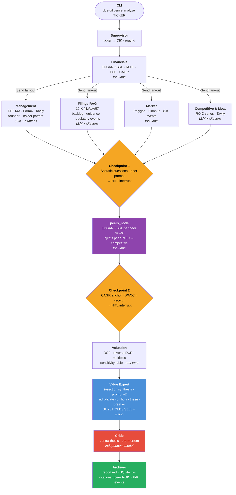

# Due Diligence Engine

An agentic system for fundamental equity analysis, built on value investing principles. Given a US ticker, it runs a full multi-specialist analysis — from SEC filings to DCF valuation — and delivers a structured verdict with citations, a pre-mortem critique, and an archived report.

> **Status:** Phase 1 + Phase 2 complete and verified. Phase 2 delivered peer ROIC comparison, earnings transcripts, 8-K event tracking, Socratic checkpoints, and Value Expert prompt v2. Phase 2.5 (same-ticker RAG) or Phase 3 (CAD/EU markets) is next.

---

## What it does

```bash
uv run due-diligence analyze AAPL
```

The pipeline:

1. **Supervisor** resolves the ticker to a CIK and routes the analysis
2. **`financials_node`** — XBRL from EDGAR: revenue, FCF, ROIC, margins, balance sheet, 5y CAGR
3. **4 specialists run in parallel** (LangGraph `Send()` fan-out):
   - `management_agent` — DEF 14A + Form 4 (insider pattern, founder detection) + Tavily (background, corporate structure) + Finnhub transcripts
   - `filings_agent` — 10-K §1/§1A/§7: business, risk factors, MD&A, **backlog, guidance, geographic revenue, specific regulatory events verbatim**
   - `market_agent` — Polygon (price, market cap, 52w) + Finnhub (news) + **EDGAR 8-K events** (Items 2.02/4.02/5.02)
   - `competitive_agent` — ROIC series + Tavily: moat classification, competitive position
4. **Checkpoint 1 (HITL, Socratic)** — data-grounded questions (moat/ROIC conflicts, insider ownership, CEO tenure); user reviews findings
5. **`peers_node`** — EDGAR XBRL for 3-5 user-supplied peer tickers; injects peer ROIC into competitive report
6. **Checkpoint 2 (HITL)** — shows historical CAGR anchor; user sets WACC, growth, projection years + justification
7. **Valuation agent** — DCF, reverse DCF, EV/EBIT, EV/FCF, P/E, sensitivity table. Zero LLM numeric generation.
8. **Value Expert** — synthesizes into 9-section analysis + BUY/HOLD/SELL. Prompt v2: must adjudicate conflicts, contrast implied growth vs CAGR, name concrete thesis-breaker
9. **Critic agent** — independent pre-mortem: weaknesses, contra-thesis, failure scenarios
10. **Archiver** — Markdown report (citations, peer ROIC table, 8-K events, operational data) + SQLite row

---

## Core design principles

| Principle | What it means in practice |
|---|---|
| **Zero numerical hallucination** | Every number comes from deterministic tools against primary sources (SEC EDGAR XBRL, Polygon). LLMs reason over data, never generate it. |
| **Mandatory verified citations** | Every qualitative claim emits a `Citation{claim, source_url, excerpt, confidence}`. Claims are validated post-hoc by substring-match against the cached filing. Unverified claims are excluded from synthesis. |
| **Provider-agnostic** | Claude primary, OpenAI fallback. No direct `anthropic`/`openai` imports in business code — all LLM access goes through `due_diligence.llm.client`. |
| **Primary sources only** | No `yfinance`, no Yahoo/Morningstar scraping. SEC EDGAR XBRL via `edgartools` is the authoritative source for all financial metrics. |
| **Tools fail loud** | Never a silent fallback from "tool broken" to "LLM invents number". Explicit error + log + branch abort if a critical metric is unavailable. |
| **Socratic HITL** | Checkpoints aren't just approval gates — they carry didactic reasoning to help the user understand what matters and why. |

---

## Architecture



---

## Installation

Requires Python 3.12+ and [`uv`](https://docs.astral.sh/uv/).

```bash
git clone https://github.com/eduardo-lezama/due_dilligence_engine.git
cd due_dilligence_engine
uv sync
cp .env.example .env   # fill in your API keys
```

### Required API keys (`.env`)

| Variable | Source | Free tier |
|---|---|---|
| `ANTHROPIC_API_KEY` | [console.anthropic.com](https://console.anthropic.com) | — |
| `OPENAI_API_KEY` | [platform.openai.com](https://platform.openai.com) | — |
| `POLYGON_API_KEY` | [polygon.io](https://polygon.io) | 5 req/min |
| `FINNHUB_API_KEY` | [finnhub.io](https://finnhub.io) | yes |
| `TAVILY_API_KEY` | [tavily.com](https://tavily.com) | 1000 req/month |

---

## Usage

```bash
# Full analysis with interactive checkpoints
uv run due-diligence analyze AAPL

# Run smoke tests (no real API calls — uses cached fixtures)
uv run pytest tests/test_smoke.py -q

# Full test suite
uv run pytest -q
```

### Output

Each analysis produces:
- **Rich CLI report** with verdict, per-share intrinsic value, and upside/downside
- **Markdown file** at `data/reports/<TICKER>-<DATE>.md`
- **SQLite row** at `data/analyses.db` (ticker, verdict, confidence, DCF upside, moat classification)

---

## Project structure

```
due_dilligence_engine/
├── src/due_diligence/
│   ├── agents/          # specialist agents, peers_node, checkpoint, value_expert, critic, archiver
│   ├── graph/           # LangGraph state (AnalysisState), graph builder, edges
│   ├── llm/             # provider-agnostic LLM client (Claude primary, OpenAI fallback)
│   ├── schemas/         # Pydantic v2 models: reports, base types, citations
│   ├── tools/           # deterministic data adapters (edgar, polygon, finnhub, tavily)
│   ├── config.py        # pydantic-settings: all env vars in one place
│   └── cli.py           # typer CLI: interactive checkpoints, Socratic questions
├── tests/
│   └── fixtures/        # cached API responses for offline testing (189 tests, zero real API calls)
├── docs/
│   ├── adr/             # Architecture Decision Records (ADR-001 … ADR-020)
│   ├── checklist-value-investing.md
│   ├── mce-evolution.md # deferred work with verifiable triggers
│   └── phase-2-strategic-review.md
├── data/
│   ├── reports/         # generated Markdown reports
│   └── analyses.db      # SQLite analysis history
├── CONCISE_EXPLANATION.md  # architecture study guide (recommended read)
├── DETAILED_EXPLANATION.md # full didactic log of all implementation decisions
└── DESIGN_DOCUMENT.md      # original project spec and research findings
```

---

## Roadmap

| Phase | Description | Status |
|---|---|---|
| **0** | Scaffolding, contracts, smoke test | ✅ Complete |
| **1a** | LangGraph skeleton + Supervisor + Financials specialist | ✅ Complete |
| **1b** | 4 parallel specialists + Checkpoint 1 HITL | ✅ Complete |
| **1c** | Valuation + Value Expert + Critic + Archiver + full CLI | ✅ Complete |
| **2** | Peer ROIC (user-supplied), earnings transcripts, 8-K events, Expert prompt v2, Socratic checkpoints | ✅ Complete |
| **2.5** | RAG memory — re-analysis delta for same ticker (ADR-013, ChromaDB) | Planned |
| **3** | Multi-market: CAD (SEDAR+) + EU (ESMA/CNMV) | Planned |
| **4** | Screener module (quantitative filter → analyst pipeline) | Planned |
| **5** | Web app (FastAPI + React/Streamlit, Docker, NAS deploy) | Planned |

See [`DESIGN_DOCUMENT.md`](DESIGN_DOCUMENT.md) for detailed phase specs, research findings, and all ADRs.

---

## Tech stack

| Layer | Technology |
|---|---|
| Runtime | Python 3.12 |
| Package management | `uv` |
| Agentic orchestration | LangGraph (state, interrupt, checkpointer) |
| LLM access | Anthropic SDK + OpenAI SDK via provider-agnostic wrapper |
| Schema validation | Pydantic v2 |
| SEC filings | `edgartools` (XBRL, primary source) |
| Market data | `polygon-api-client` (prices, market cap) |
| Transcripts / news | `finnhub-python` |
| Web search | Tavily |
| CLI | `typer` + `rich` |
| Storage | SQLite + filesystem |
| Testing | pytest + cached fixtures (zero real API calls) |
| Logging | `structlog` (structured JSON) |

---

## License

Apache 2.0 — see [LICENSE](LICENSE).
