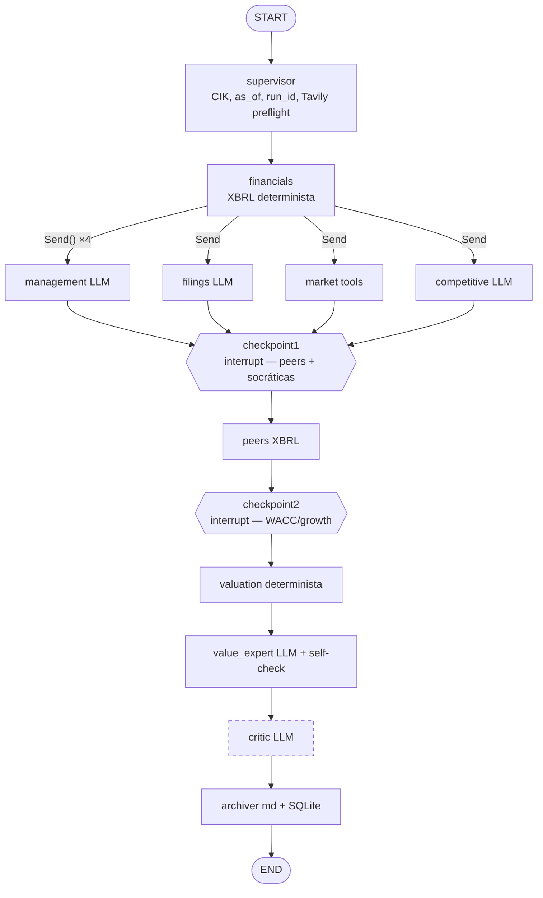

# Evaluación de arquitectura y hoja de ruta — Due Diligence System

**Fecha**: 2026-10-02
**Alcance**: diseño completo (orquestación, datos, valoración, razonamiento, evaluación) + investigación externa de frameworks, técnicas y fuentes de datos.
**Método**: tres auditorías de código independientes (orquestación, capa financiera, capa de razonamiento), dos líneas de research externo (frameworks agentic 2026, metodología y datos de valoración), más verificación manual de cada hallazgo crítico contra el código y contra `data/analyses.db`. Todas las referencias `archivo:línea` fueron comprobadas en el working tree actual (incluye cambios sin commit).

---

## 1. Resumen ejecutivo

El sistema tiene una **arquitectura correcta** para el problema: DAG determinista con carril de tools separado del carril LLM, schemas Pydantic, HITL socrático, Critic independiente, 31 ADRs y 67 edge cases documentados. Esa disciplina está muy por encima de la media de proyectos personales y coincide con lo que hacen los sistemas financieros serios de 2026 (TradingAgents, FinRobot V2: "models reason, software computes, agents orchestrate, systems verify").

Pero **la implementación no cumple tres de los seis invariantes declarados**, y el output tiene un problema de primer orden que ninguna auditoría externa de un ticker individual podía detectar:

| Hallazgo | Evidencia |
|---|---|
| **El veredicto está desacoplado de la valoración** | 44 de 51 análisis en SQLite son HOLD. 25 de esos HOLD tienen DCF upside > 30 % (CALM +3483 %, LULU +341 %, SYM +332 %). 7 HOLD tienen downside < −20 % (KTOS −96 %). Confianza siempre en 0.61–0.84. Sizing = 2 % en 25 de 41 reports. |
| **La validación de citas no existe** (invariante 2) | `Citation.verified` nunca se asigna; no hay código de substring-match. La `confidence` de cada cita la declara el propio LLM. |
| **Un fallo de parseo produce un HOLD archivado** (invariante 5) | `value_expert.py:745-753` devuelve `verdict="HOLD"`, `stub=False`; la CLI lo guarda como `TICKER-HOLD.md`. `2026-04-25-DRS-HOLD.md` contiene "Parse error". |
| **El LLM genera números presentados como datos** (invariante 1) | `insider_ownership_pct`, `ceo_tenure_years`, `form4_transactions_12m`, `backlog_usd` salen del JSON del LLM. |
| **Datos extraídos que no llegan a la síntesis** | `governance_red_flags` (EC-66, marcado resuelto) no lo lee ni Value Expert, ni Critic, ni Archiver. Las respuestas socráticas del checkpoint 1 se envían (`cli.py:691`) y ningún nodo las consume. |
| **Errores de extracción del balance** | Deuda a corto suma conceptos solapados (`edgar.py:321-346`); STI fijado a 0 (`edgar.py:363`); el trimestre "más reciente" se elige ordenando strings (`edgar.py:682-690`, "Q4 2025" > "Q1 2026"). |

**Sobre la pregunta central (¿migrar a deepagents / Agent SDK?)**: **no**. Mantener LangGraph, subir a 1.2.x, y usar autonomía acotada solo dentro de nodos concretos. El razonamiento está en §5. El problema del sistema no es el orquestador: es que la capa de razonamiento no está evaluada y la capa de datos tiene bugs de dinero real que el DAG oculta en vez de exponer.

**Palanca más barata de calidad**: la síntesis y el Critic corren en `gpt-5.4-mini` a unos 0,02 € por análisis. Un modelo frontier de razonamiento solo en esos dos nodos costaría del orden de 0,3–1 € por decisión. Irrelevante frente al tamaño de una posición.

---

## 2. Métricas base

| Métrica | Valor |
|---|---|
| Líneas `src/` | 9 227 (edgar.py 1 638, valuation.py 1 298, value_expert.py 990, cli.py 776) |
| Tests | 390 funciones en 25 archivos, LLM siempre mockeado |
| System prompt Value Expert | 16 774 chars (~4,2K tokens), 22 reglas numeradas, 12 de ellas nacidas de un ticker concreto |
| Análisis en SQLite | 51 (8 tickers repetidos; BBW ×5) |
| Coste medio registrado | 0,02 €/análisis, 21,5K tokens in, 3,9K out (solo camino OpenAI; el camino Claude no acumula `usage`) |
| Versiones instaladas | langgraph 1.1.8 (actual 1.2.12), edgartools 5.30.0 (actual 5.59.1), anthropic 0.96, openai 2.32 |
| Working tree | 1 321 líneas sin commit en 15 archivos desde mayo 2026 (último commit 2026-07-22 fue limpieza) |

---

## 3. Fortalezas (lo que no hay que tocar)

- **Separación determinista / probabilística real**: `financials`, `peers` y `valuation` no llaman al LLM. Los 4 métodos de valoración, la convergencia y el reverse DCF son Python puro.
- **Nodos puros `state -> dict`**, acoplamiento mínimo a LangGraph (solo `graph.py`, `checkpoint.py` y la CLI). Migrar o refactorizar el orquestador sería barato si hiciera falta.
- **Rúbrica de moat con downgrade determinista** (ADR-024): el patrón correcto, extensible a otras secciones.
- **Critic separado y con red flags precalculados** (MCE-23). La literatura 2026 sobre "convergencia sicofántica" en debates multi-agente respalda exactamente este diseño.
- **Reverse DCF como ancla principal**, cap del growth al CAGR de revenue, fade Damodaran, notas de fiabilidad (FCF quality, WACC advisory, spread DCF/reverse).
- **Disciplina documental**: ADRs inmutables, EC con causa raíz, auditoría post-fix (MCE-26), tests de arquetipos (MCE-25), errores de dominio didácticos (EC-36).
- **Preflight de cuota Tavily**, detección de 10-K/A, rechazo explícito de financieras y 20-F.

---

## 4. Hallazgos verificados, por capa

Prioridad: **Alto** = afecta al veredicto o viola un invariante. **Medio** = degrada calidad o fiabilidad. **Bajo** = deuda.

### 4.1 Output y calibración

**[Alto] H1 — Colapso del veredicto en HOLD.** La rúbrica genera sesgo HOLD por construcción: BUY exige 5 condiciones simultáneas (`value_expert.py:116-117`), la regla 21(c) dice "if methods diverge → adopt HOLD bias", SELL exige downside + red flags. La confianza es auto-declarada por el LLM y el único control es `sizing ≤ conf × 10` (`value_expert.py:711-720`), que es coherencia interna, no fundamento. QLYS salió BUY (72 %, 7 %) el 05-11 y HOLD (72 %, 2 %) el 05-17 con los mismos datos. "HOLD 2 %" no es una decisión ejecutable para quien no tiene la posición.

Propuesta: taxonomía **BUY / WATCHLIST (con precio de entrada = intrínseco × (1 − MoS)) / PASS / SELL-if-owned**, confianza derivada de señales deterministas (convergencia de métodos, spread reverse/forward, calidad de datos, nº de citas verificadas) con el LLM ajustando solo dentro de una banda, y sizing basado en margen de seguridad y downside, no en confianza.

### 4.2 Capa de razonamiento (prompts, síntesis, Critic)

**[Alto] H2 — Citas sin validar.** `filings.py:160-170`, `management.py:233-245`, `competitive.py:225-236` construyen `Citation` directamente del JSON del LLM. Ejemplo real (KBR): cita "CEO ... net buyer: purchased 8,375 shares" con 100 % de confianza, pero el excerpt es del CFO. Un substring-match estricto tampoco lo detectaría (el excerpt sí está en la fuente): hace falta además comprobar que el *claim* se sostiene en el *excerpt*. Implementación recomendada: normalizar (espacios, comillas, `$1.2 billion` vs `$1,200 million`), fuzzy `partial_ratio ≥ 90` con rapidfuzz contra el **mismo texto truncado** que recibió el prompt, verificación aparte de cada token numérico, y un validador LLM barato claim-vs-excerpt solo cuando el fuzzy pasa.

**[Alto] H3 — El Critic no cambia nada.** Grafo lineal `valuation → value_expert → critic → archiver` (`graph.py:156-159`). El output del Critic solo se añade al markdown (`archiver.py:326-338`). Recibe solo §1, §2 y §6 etiquetados como "Bull case summary" (`critic.py:87-92`), aunque en 40 de 41 casos el veredicto es HOLD o SELL. Usa el mismo modelo que el Expert (`critic.py:289`, contra ADR-003) con `max_tokens=1024`. El thesis-break self-check (ADR-031) solo añade un caveat (`value_expert.py:916-922`): apareció en 5 reports y no cambió ningún veredicto.

Cuidado con la solución: la evidencia 2026 (arXiv 2609.29701) dice que los bucles crítica→revisión producen convergencia sicofántica y **preservar el desacuerdo** es lo que mejora el Sharpe. La reconciliación debe ser **determinista**, no otra llamada LLM: un nodo que ajuste confianza/sizing con reglas en función de la severidad de los puntos del Critic, y que muestre el desacuerdo en el report sin suavizarlo.

**[Alto] H4 — Prompt como registro de parches.** 12 de 22 reglas vienen de un ticker (MOS → regla 12 con ejemplo de fertilizantes; DRS → 16; ANET → 17; CXDO → 19; PATH → 22). Reglas que prohíben palabras ("MUST NOT write 'declining ROIC'") tapan el síntoma. Reglas condicionales (16, 18–21) se cargan siempre aunque su bloque de datos no exista. Bug de renumeración: el bloque M&A dice "Per Rule 18" (`value_expert.py:390`) pero la regla de adquisiciones es la 19. Sin few-shot completo. Umbrales duplicados en código y prompt (reinvestment 20/50 %). Cortes de insiders ($50K/$250K) absolutos, no escalan con tamaño ni compensación.

Propuesta: **constitución estable** (rol, método, formato) + **reglas adjuntas al bloque de datos que las activa** (se inyectan solo cuando el bloque existe) + **validadores deterministas post-output** por regla (ver §4.6).

**[Medio] H5 — Contexto infra-alimentado, no sobrecargado.** Item 1 truncado a 8K chars (`edgar.py:1041`), 1A y MD&A a 10K (`:1073`, `:1159`); un MD&A real tiene 50–150K. Quarterly a 2 500 chars, 8-K no-M&A a 200 chars, 3 citas de management a 400 chars. El Expert recibe ~4–6K tokens de datos frente a 4,2K de reglas. FinanceBench mostró que long-context sobre secciones completas supera a RAG de fragmentos en 10-K (21 % vs 81 % de fallos). Opciones sin vector store: (a) extracción por subsección (Results of Operations, Liquidity, Backlog, Critical Estimates); (b) tool `get_filing_section(item, query)` con BM25 sobre el 10-K cacheado para que el especialista pida lo que necesita; (c) pasar Items 1, 1A y 7 completos al filings agent, que con 200K de contexto cuesta céntimos.

**[Medio] H6 — Números del Expert sin control.** Regla 1 pide "VERBATIM", pero nadie lo verifica. KBR: calcula $256 425 cuando 8 375 × $30,60 = $256 275 (aritmética del LLM); mezcla FCF FY2024 con capital devuelto FY2025 y concluye "98 % of FCF". Validador determinista propuesto: todo número de la síntesis debe aparecer en el contexto o derivarse de él con tolerancia.

**[Medio] H7 — Huecos del checklist (invariante 6)** sin ningún agente ni tool: §3.7 shareholder letters, §4.5 DuPont, §4.7 share count 10 años, §5.3 TAM, §5.4 unit economics, §6.4 PEG, §6.7 Graham/NCAV, §7.1 concentración determinista, §7.5 debt walls, §7.6 dilución, §7.8 posición en el ciclo, §8.3 base rates, §9.1 MoS objetivo, §9.3 kill criteria como lista, §9.4 sell triggers, §9.5 review cadence. §8 y §9 enteros son dos strings libres. Las preguntas del checklist están copiadas a mano en los prompts en vez de generarse desde `docs/checklist-value-investing.md`.

### 4.3 Capa de datos y valoración

**[Alto] H8 — Puente EV ↔ equity incoherente entre métodos.** El FCF es OCF − capex (apalancado). `_three_stage_dcf` lo descuenta a la tasa del usuario y divide por acciones sin restar deuda neta (`valuation.py:1049-1063`). La tasa "WACC advisory" es Rf + β·ERP sin coste de deuda (`valuation.py:320-322`), es decir, coste del equity. Interpretado así, el camino FCF es un **modelo FCFE internamente coherente, mal etiquetado**. El error real está en: (a) el fallback NOPAT (EC-13, `valuation.py:1038-1042`) usa flujos **desapalancados** y tampoco resta deuda neta, lo que sobrevalora justo a los cíclicos apalancados; (b) el EPV sí resta deuda neta de un enterprise value calculado con la misma tasa (`valuation.py:423`), así que la tabla de convergencia (ADR-030) compara métodos no homogéneos; (c) la docstring de `_compute_epv` dice "EPV_enterprise es comparable con market_cap (ambos enterprise-level)", que es falso (market cap es equity). Además faltan: SBC restado del FCF (PATH tiene SBC enorme), dilución (se usan acciones básicas de portada, `edgar.py:429`), leases ASC 842, NCI, preferentes, caja excedente.

**[Alto] H9 — Extracción del balance.**
- Deuda a corto **suma** `ShortTermBorrowings + LongTermDebtCurrent + ... + DebtCurrent` (`edgar.py:321-346`). El comentario dice "mutually-exclusive"; no lo son, `DebtCurrent` suele agregar los otros. `LongTermDebt` incluye vencimientos corrientes → doble conteo.
- `sti_value = 0.0` fijo (`edgar.py:363`); la caja no tiene fallback a raw facts ni a `CashCashEquivalentsRestrictedCash...`; se ignoran inversiones a largo. Deuda neta sobreestimada en empresas con caja → EV/EBIT inflado, EPV deprimido. El Expert lo etiqueta "Cash + STI".
- `_get_point` (`edgar.py:278-282`) devuelve el primer valor no nulo de cualquier columna FY pero lo etiqueta con `fy_label`.
- Trimestre más reciente elegido con `sorted(reverse=True)` sobre strings (`edgar.py:682-690`): "Q4 2025" > "Q1 2026". El test `test_edgar.py:558-560` es tautológico (`assert called or result is None`).
- Fixture BBW: labels `FY2026, FY2024, FY2023, FY2022`, falta un ejercicio; los CAGR asumen años consecutivos por índice (`financials.py:47-50`, `valuation.py:79`). FCF hace `zip` por posición, no por periodo (`edgar.py:476-484`).

**[Alto] H10 — ROIC mal definido.** La serie usa el IC del último año para todos los años y el tipo impositivo del último año (`edgar.py:557-568`): es la tendencia del EBIT, no del ROIC. `value_expert.py:209-224` presenta su delta como "marginal ROIC" sin ser ΔNOPAT/ΔIC. EC-58 se apoya en esta señal espuria. IC fallback = Total Assets − Cash incluye pasivos sin coste.

**[Medio] H11 — Métricas de calidad ausentes.** No se extraen D&A, SBC, intereses, AR, inventario ni pasivo corriente. Por tanto no hay Piotroski F, Altman Z, Beneish M, accruals (Sloan), conversión CFO/NI, cobertura de intereses, owner earnings ni SBC/FCF. Todo es calculable desde XBRL sin LLM y alimentaría al Critic con hechos.

**[Medio] H12 — EPV y WACC.** EPV filtra solo EBIT positivos (`valuation.py:344`, sesgo alcista en cíclicos), sin ajuste D&A vs capex de mantenimiento, tipo impositivo 1 − NI/EBIT. Rf = 4,2 % fijado en código "as of 2026-05", β = 1. Si `wacc ≤ g` ajusta en silencio a g = wacc − 0,5 % (`valuation.py:118-119`) en vez de fallar. Sensibilidad: solo 3×3 g1 × WACC, en billones con 1 decimal y valor total, no por acción; sin eje de g terminal ni % del valor terminal; sin escenarios ni Monte Carlo.

**[Medio] H13 — Patrón EC-14 (`/1e9`) sigue vivo** en `checkpoint.py:186,194` (justo donde el usuario decide WACC y growth: una small cap ve "$0.0B") y `valuation.py:707`. La auditoría MCE-26 no llegó a esos archivos.

**[Medio] H14 — Whack-a-mole estructural en XBRL.** 12–15 de los 67 EC son de extracción. El patrón "primer concepto no vacío gana" no fusiona cambios de concepto en el tiempo, trabaja sobre una vista curada que omite conceptos (EC-37) y no valida identidades contables. Alternativas por esfuerzo: (1) `XBRLS.from_filings(filings.filter(amendments=False).head(5))` con índice `standard_concept` y columnas por fecha de cierre (resuelve labels FY); (2) mantener cadenas pero añadir **validación por identidades** (Assets = L + E, GP ≤ Revenue, |DebtCurrent − Σcomponentes| < ε, periodos contiguos por `period_end`), fallando loud si no cuadra; (3) SEC Frames API como cross-check y para percentiles sectoriales; (4) mapeo asistido por LLM solo en modo propose → validate, nunca aportando el valor.

**[Medio] H15 — edgartools 5.30 → 5.59.** Las 5.5x corrigen bugs silenciosos que afectan directamente: capex con signo positivo en 3 caminos, `get_total_liabilities()` devolviendo L + E (ahora `None` si no existe `us-gaap:Liabilities`), `get_revenue()` devolviendo componente, TTM sumando acciones en vez de promediar, `quarterize()` con trimestres de 457 días, `XBRLS.from_filings()` tragándose excepciones. Cualquier código que trate `None` como 0 se rompe al actualizar. Hacer el upgrade con el grep MCE-26 y los tests de arquetipos.

**[Bajo]** Fixtures `*_xbrl_raw.json` son la **salida** de `fetch_raw`, no las respuestas crudas: toda la lógica de cadenas y etiquetas (`edgar.py:45-436`) queda sin testear. El test de arquetipo acepta ROIC entre −5 y 100 (−500 % a 10 000 %). Fixture AAPL con buybacks vacíos. Polygon solo 365 días (sin drawdown multianual). Sin convención de mitad de año.

### 4.4 Orquestación y cliente LLM

**[Alto] H16 — Salida estructurada a mano.** Todos los agentes hacen `find("{")`/`rfind("}")` + `json.loads` (`filings.py:153-158`, `management.py:231`, `competitive.py:223`, `critic.py:239`, `value_expert.py:690,815`). Solo VE usa `json_object`, que garantiza JSON válido pero no el schema. Los Pydantic se construyen campo a campo con `.get()`, nunca `model_validate`, así que el schema nunca rechaza nada. Truncación: en OpenAI `finish_reason=="length"` solo genera warning (`client.py:196-203`); en Anthropic ni se mira `stop_reason`. Origen de EC-03 y EC-49. Fix: una sola función `llm.structured(schema, ...)` con structured outputs nativos (OpenAI `json_schema` strict / Anthropic tool-use), `model_validate`, y truncación como excepción tipada.

**[Alto] H17 — Fallback indiscriminado.** `client.py:137` captura cualquier `Exception` (incluidos bugs) y cambia de proveedor y modelo sin registrarlo en el report. Routing por presencia de key, no por prefijo del modelo. `default_model="claude-sonnet-4-6"` es engañoso: sin API key de Anthropic todo va por OpenAI. `_MODEL_PRICING` no tiene modelos Claude y `_complete_anthropic` no acumula `usage`.

**[Medio] H18 — Estado y persistencia.** `citations`, `unverified_claims`, `cost_usd` en `state.py:103-105` son contratos muertos (nadie los escribe tras el supervisor). Sin reducers (`Annotated[list, add]`) pese a enseñarlo AGENTIC_PATTERNS §3. `checkpoint*_user_input` son `dict` libres; `CheckpointInput` no existe. CLI usa `MemorySaver` (`cli.py:638`): un Ctrl+C pierde el run; `interrupt()` funciona hoy como un `input()` caro. ADR-020 (msgpack no serializa Pydantic) está obsoleto con langgraph-checkpoint 4.x: un test de round-trip con `SqliteSaver` de 10 minutos lo cerraría.

**[Medio] H19 — Observabilidad.** Nunca se llama a `structlog.configure`: salida ConsoleRenderer, no JSON. Sin `bind_contextvars(run_id=...)`. `thread_id=f"{ticker}-latest"` no coincide con `run_id`. No se registra por nodo latencia, modelo real usado, tokens ni si hubo fallback. Singleton `RunStats` no es thread-safe (el fan-out corre en pool de hilos).

**[Bajo]** `Send()` usado para fan-out estático (4 `add_edge` harían lo mismo). `management`, `filings`, `market` no dependen de `financials` y podrían salir del supervisor. `valuation` podría correr **antes** del checkpoint 2 con defaults para que el usuario vea el growth implícito antes de fijar hipótesis. Defaults de checkpoint 2 triplicados (nodo, CLI, valuation). Funciones de 350–530 líneas (`_format_context`, `valuation_agent`, `fetch_raw`, `_render_markdown`).

### 4.5 Topología actual

Línea discontinua: el Critic no tiene salida hacia ningún nodo que modifique el veredicto.

### 4.6 Evaluación: no existe

Los 390 tests mockean siempre el LLM y comprueban que cadenas aparecen en el prompt, no cómo se comporta el modelo. No hay golden reports, LLM-as-judge, regresión de veredictos ni medida de estabilidad. El único juez de calidad son las auditorías manuales con Opus, cuyos juicios no se guardan como datos.

**Bucle de auditoría externa → fixes**: mixto, cada vez más inclinado al parche local. Lo que funciona: fixes que precalculan en Python (reinvestment mode, etiqueta ROIC, 10b5-1 en tres capas, detección M&A, formatter central). Lo que no: cada ticker auditado añade una regla con nombre propio; nada comprueba que la regla N+1 no rompa la N; los fixes se cierran en la capa del síntoma sin seguir el dato hasta el report (EC-23, EC-66); se valida re-corriendo un solo ticker.

**Harness mínimo propuesto**:
1. **Dataset congelado**: serializar el `AnalysisState` previo al Value Expert (o la salida de `_format_context`) para los 41 tickers ya analizados en `tests/evals/contexts/`. Separa razonamiento de fetch; cada corrida del Expert cuesta < 0,01 $.
2. **Capa A, aserciones deterministas (un EC = un check)**: números de la síntesis ⊂ números del contexto; EC-58 narrativa no contradice label ROIC; EC-45 thesis-breaker no es ya verdadero; EC-50 10b5-1 no bajista; EC-53 si hay bloque M&A, §4 menciona staleness; EC-66 si hay governance flags, aparecen en §7; regla 21 conteo de convergencia presente. Contextos sintéticos mínimos por EC → los 67 edge cases se convierten en suite de regresión.
3. **Capa B, LLM-as-judge**: rúbrica 0–3 por sección §1–§9 del checklist + "¿es accionable para un PM?". Juez de otra familia (Claude si el Expert es GPT). Comparación pareada baseline vs candidato. Calibrar contra las auditorías Opus guardadas como etiquetas.
4. **Capa C, estabilidad**: N=5 muestras por contexto; tasa de cambio de veredicto y desviación de confianza. Un cambio de prompt no puede subirla. QLYS es el primer caso.
5. **Capa D, tests metamórficos**: subir WACC baja el intrínseco; duplicar acciones divide el per-share; sustituir el ticker por "Company X" no mueve el veredicto más de un umbral (mide sesgo por nombre/memoria del modelo).
6. **Capa E, prospectiva**: predicciones fechadas con probabilidad verificables a 1–4 trimestres (dirección de revenue, cumplimiento de guidance, margen), guardadas en SQLite, Brier score. ADR-021 ya guarda el precio: retorno a 6/12 meses vs SPY por veredicto.
7. **Gate**: `uv run pytest tests/evals -m eval` obligatorio antes de tocar cualquier `_SYSTEM_PROMPT`, con scorecard JSON comparado contra baseline.

Herramientas: **Pydantic Evals** (encaje óptimo, no obliga a usar Pydantic AI, `LLMJudge(rubric=...)`, YAML, OTel opcional) o **DeepEval** (`GEval`, estilo pytest). LangSmith/Braintrust requieren SaaS, contra el enfoque offline-first.

---

## 5. ¿LangGraph o deepagents / Agent SDK / otros?

**Veredicto: mantener LangGraph. Subir a 1.2.x. Autonomía acotada solo dentro de nodos.**

Estado verificado a 2026-10-02: langgraph 1.2.12, deepagents 0.7.21, langchain 1.4.3, claude-agent-sdk 0.2.163, pydantic-ai 2.53, google-adk 2.11 GA, autogen en maintenance mode.

| Opción | Qué aporta | Qué rompe aquí | Veredicto |
|---|---|---|---|
| **LangGraph 1.2.x** | `TimeoutPolicy` por nodo, `error_handler=` en `add_node` (saga), `RetryPolicy`, `CachePolicy`, `invoke(version="v2")` con output Pydantic. Migración 1.1→1.2 no disruptiva. LangChain lo sigue definiendo como *el* runtime para "workflows que combinan pasos deterministas y agénticos". | Nada | **Mantener y actualizar** |
| **deepagents 0.7** | Harness sobre LangGraph: FS virtual, subagentes vía tool `task`, summarization, offloading, skills, prompt caching Anthropic, HITL `interrupt_on` por tool-call. | El fan-out lo decide el LLM (no determinista) → rompe invariantes 1, 5, 6. HITL por tool-call, no checkpoint socrático arbitrario. 0.x con cambios de formato de checkpoint sin rollback (0.6). LangChain lo recomienda para "complex, non-deterministic tasks"; este problema es determinista. | **No como orquestador** |
| **LangChain 1.x middleware** (`create_agent`) | `ModelFallbackMiddleware`, `ModelRetryMiddleware`, `SummarizationMiddleware`, `AnthropicPromptCachingMiddleware`, structured output nativo. | Solo actúa dentro del bucle de `create_agent`; los nodos aquí llaman al LLM una vez con schema. Sería `init_chat_model` + `.with_fallbacks()`: cambio lateral. CLAUDE.md prohíbe "LangChain completo"; ADR-004 fija el wrapper propio. | **No sustituye el wrapper**; arreglar el wrapper (H16, H17) |
| **Claude Agent SDK / Managed Agents** | Subagentes, hooks, MCP, sesiones, structured output. Managed Agents en beta pública desde 2026-04, 0,08 $/h + tokens. | Solo modelos Claude → rompe ADR-004 y la realidad de que el usuario opera por OpenAI. Agente autónomo, no DAG. Lock-in. | **No** |
| **Pydantic AI 2.x** | Type-safe, `pydantic-graph`, durable execution (Temporal/DBOS), Pydantic Evals integrado. FinRobot V2 migró a él. | Migración completa sin ganancia funcional neta sobre LangGraph. | **No migrar; sí adoptar Pydantic Evals** |
| OpenAI Agents SDK, CrewAI, Google ADK, smolagents, Mastra, AutoGen | — | Handoffs/roles/Gemini/TS/mantenimiento. | **No** |

**Razonamiento de fondo.** El checklist canónico es un proceso conocido con orden epistémico fijo: hechos → juicio humano → valoración → síntesis → crítica. La autonomía aporta valor cuando no se sabe qué pasos hacen falta; aquí se sabe. ADR-005 exige que los números salgan de tools deterministas: en un DAG se cumple por construcción, en un agente depende de que el LLM elija bien. Anthropic ("Building effective agents": "workflows para tareas bien definidas, agentes para flexibilidad"; "multi-agent research": 15× tokens, encaja en tareas abiertas y paralelizables, no con muchas dependencias) y Cognition ("Don't build multi-agents": subagentes paralelos toman decisiones contradictorias; aquí mitigado porque los especialistas no deciden) apuntan igual. Todos los proyectos financieros serios revisados (TradingAgents, FinRobot V2, ai-hedge-fund) usan DAG fijo con cálculo determinista.

**Dónde sí tiene sentido la micro-agencia (híbrido acotado)**: convertir `filings` y `competitive` en mini-agentes ReAct con tools (`get_filing_section`, Tavily), presupuesto de pasos y `response_format` Pydantic, **como subgrafo dentro del nodo**. El grafo exterior sigue siendo determinista. Es la respuesta a H5 sin vector store. Requiere un ADR nuevo que levante parcialmente la prohibición de LangChain si se usa `create_agent`; también se puede hacer con un bucle propio de 40 líneas sobre el wrapper existente.

**Lo que empaqueta deepagents y conviene copiar a mano** (no adoptar): prompt caching del system prompt del Expert, offloading de outputs grandes a disco en vez de al estado, subagentes que devuelven 1–2K tokens estructurados.

---

## 6. Investigación externa: técnicas y datos, ordenadas por impacto/esfuerzo

| # | Acción | Impacto | Esfuerzo | Nota |
|---|---|---|---|---|
| 1 | Upgrade edgartools 5.30 → 5.59 + grep MCE-26 + arquetipos | Muy alto | Bajo | Fixes de signos de capex, pasivos, TTM, quarterize (H15) |
| 2 | Scores contables deterministas: Beneish M, Sloan accruals, Piotroski F, Altman Z (excluir financieras y equity negativo), CFO/NI, SBC/FCF, cobertura de intereses, DSO/DIO/DPO, goodwill/impairments | Alto | Bajo | Todo XBRL, sin LLM; alimenta al Critic con hechos (H11) |
| 3 | DCF por escenarios bear/base/bull con probabilidades fijadas en checkpoint 2 + Monte Carlo ligero (10K iter. sobre g1, margen terminal, reinversión, WACC, con g = ROIC × reinversión para coherencia). Reportar P(valor > precio) y percentiles | Alto | Medio-bajo | Determinista con semilla. Damodaran "Probabilistic Approaches" |
| 4 | Normalización cíclica: margen y ROIC medio/mediano 7–10 años para EPV y stage 1; owner earnings con capex de mantenimiento (Greenwald: capex − PP&E/ventas × Δventas) | Alto | Bajo | Greenwald exige earnings normalizados |
| 5 | Expectations investing completo: traducir growth implícito del reverse DCF a revenue/margen/ROIC implícitos y compararlo con **base rates** por tamaño (Mauboussin) construidas con SEC Frames API | Alto | Medio | "El precio exige un crecimiento que solo alcanza el X % de empresas de este tamaño" |
| 6 | Rf desde FRED `DGS10`; β desapalancada por industria y ERP mensual desde los datasets gratuitos de Damodaran | Medio | Bajo | Sustituye 4,2 % y β=1 hardcoded (H12) |
| 7 | Transcripts: 8-K Item 2.02 Ex.99.1/99.2 vía edgartools (gratis, ya parcialmente usado; falta extraer KPIs y guidance) + Equibles (100 req/día gratis, ToS por verificar) | Medio-alto | Bajo | Finnhub free está vacío (EC-48). Evitar scraping de SA/Motley Fool (ADR-011) |
| 8 | Short interest FINRA API (gratis, bimensual, 5 años); 13F desde SEC Form 13F Data Sets; segmentos vía dimensiones XBRL (`srt:ProductOrServiceAxis`) | Medio | Bajo | Todo primario y gratis |
| 9 | Contraste EPV vs valor de reproducción de activos (Greenwald): EPV > activos ⇒ franquicia, debe ser coherente con el veredicto de moat | Medio | Medio | Mecanizable con supuestos explícitos |
| 10 | Scoring de asignación de capital: CAGR de acciones, recompras vs intrínseco estimado en su momento, M&A vs impairments, payout vs ROIC − WACC | Medio | Medio | Extiende incremental ROIC |
| 11 | Consensus: no hay fuente gratuita buena. Alternativa coherente con value: reverse DCF vs guidance del 8-K | — | — | Ya encaja con el diseño |
| 12 | Backtest point-in-time con SEC Financial Statement Data Sets (as-filed desde 2009) + precios sin sesgo de supervivencia, empresas anonimizadas, periodos post-cutoff del modelo | Alto a largo plazo | Alto | No existe dataset público 10-K + retornos; hay que construirlo |

**Literatura 2026 relevante para el diseño**:
- *The Price of Agreement* (ICLR 2026 FinAI): las preferencias del usuario inyectadas en el contexto hacen fallar a la mayoría de modelos. Implicación: separar datos de opiniones del usuario en los inputs HITL (hoy `growth_justification` va mezclado en el contexto del Expert).
- *Multi-Agent Debate* (arXiv 2609.29701): convergencia sicofántica en bucles crítica→revisión; preservar el desacuerdo mejora Sharpe +0,14; "reasoning quality" medida no correlaciona con retornos. Respalda H3.
- *When Summaries Distort Decisions* (EMNLP 2026): los resúmenes de 10-K cambian la decisión por descontextualización (el dato se conserva, el caveat se pierde). Afecta a la compresión especialista → Expert (H5).
- *FrontierFinance* (ago-2026): el harness de herramientas pesa más que el modelo. *Look-Ahead-Bench*: sesgo significativo en periodos dentro del entrenamiento (relevante para backtests).
- Kim/Muhn/Nikolaev ("Financial Statement Analysis with LLMs") está **retirado** de arXiv; no citarlo como evidencia.

---

## 7. Hoja de ruta recomendada

Principio: **primero que el sistema no mienta, luego que razone mejor, luego que sepa más**. Cada ítem de H1 es un fix sistémico, no por ticker.

### Horizonte 1 — Integridad (2–3 semanas). Cierra los invariantes rotos.

1. **Commit del working tree** (1 321 líneas sin commit desde mayo). Es riesgo puro.
2. **`llm.structured()`** única: structured outputs nativos + `model_validate` + truncación como excepción tipada + routing por prefijo de modelo + `usage` en ambos proveedores + registrar modelo real usado en el report (H16, H17).
3. **Fail loud de verdad**: parse fallido → report `INCOMPLETE`, sin veredicto, sin archivo `-HOLD.md` (H3/A6). Cambiar `except Exception` del fallback por excepciones de API concretas.
4. **Validación de citas** (H2): fuzzy normalizado + verificación numérica + claim-vs-excerpt con modelo barato. Poblar `citations`/`unverified_claims` del estado. Excluir de síntesis las no verificadas, como dice ADR-005.
5. **Seguir el dato hasta el report**: `governance_red_flags` → Expert §7 + Critic; `answers` socráticas → Expert. Añadir a MCE-26 la regla "todo campo nuevo del schema debe tener un consumidor en síntesis o archiver, con test".
6. **Balance** (H9): deuda a corto con prioridad excluyente (`DebtCurrent` si existe, si no suma de componentes), caja con fallback raw facts + STI + inversiones a largo, `_get_point` que falle si el periodo no coincide, orden de trimestres por `period_end`. Tests con fixtures **crudas** de companyfacts, no con la salida de `fetch_raw`.
7. **Puente EV↔equity** (H8): decidir y documentar en un ADR que supersede ADR-029/030: o FCFE a coste de equity (y renombrar) o FCFF a WACC real con deuda neta restada. El camino NOPAT debe restar deuda neta sí o sí. SBC restado del FCF. Convergencia solo entre métodos homogéneos.
8. **`/1e9` restantes** y upgrade edgartools con grep MCE-26 + arquetipos.

### Horizonte 2 — Razonamiento evaluable (3–4 semanas)

9. **Harness de evals** (§4.6): dataset congelado de los 41 contextos, capa A (un EC = un check), capa C (estabilidad N=5), capa D (metamórficos). Gate antes de tocar prompts. Pydantic Evals o DeepEval.
10. **Taxonomía de veredicto y confianza derivada** (H1): BUY / WATCHLIST con precio de entrada / PASS / SELL-if-owned; confianza compuesta por señales deterministas; sizing por MoS y downside.
11. **Reestructurar el prompt del Expert** (H4): constitución + reglas adjuntas a bloques + validadores post-output + un few-shot completo. Reglas por ticker → generalizar o convertir en check determinista.
12. **Nodo de reconciliación determinista** post-Critic (H3): ajusta confianza/sizing por severidad, preserva y muestra el desacuerdo. Critic con modelo distinto al Expert (ADR-003), con `max_tokens` suficiente y recibiendo quarterly, 8-K y management.
13. **Modelo frontier de razonamiento** solo en Expert y Critic. Medir con el harness antes/después.
14. **ROIC por año e incremental real** ΔNOPAT/ΔIC (H10); IC con pasivos sin coste excluidos.

### Horizonte 3 — Saber más (continuo)

15. Scores contables (fila 2 de §6), escenarios + Monte Carlo (fila 3), normalización cíclica y owner earnings (fila 4), base rates con Frames API (fila 5), Rf/β/ERP vivos (fila 6).
16. **Contexto bajo demanda** (H5): `get_filing_section` con BM25 sobre 10-K cacheado; `filings` y `competitive` como mini-agentes acotados dentro del nodo. ADR que lo autorice.
17. Transcripts 8-K Ex.99 + Equibles, FINRA short interest, 13F, segmentos XBRL (filas 7–8).
18. `SqliteSaver` (cerrar ADR-020 con test round-trip), `structlog.configure` JSON + `bind_contextvars(run_id)`, `TimeoutPolicy`/`error_handler` de LangGraph 1.2, `valuation` con defaults antes del checkpoint 2.
19. Capa E prospectiva (predicciones fechadas + Brier) y, con tiempo, backtest point-in-time (fila 12).

### Lo que NO hacer

- Migrar el orquestador a deepagents, Agent SDK, Managed Agents, Pydantic AI o CrewAI.
- Añadir una regla más al prompt del Expert sin un check determinista que la cubra en el harness.
- Añadir un campo al schema sin consumidor en síntesis y test.
- Un bucle Expert ↔ Critic de revisión iterativa (convergencia sicofántica).
- Vector store / RAG de memoria antes de tener el harness (MCE-12 sigue bien diferido).

---

## 8. Riesgos de proceso

- **1 321 líneas sin commit desde mayo de 2026** en 15 archivos, incluido ADR-031 sin trackear. Un `git stash` accidental o un disco perdido borra cuatro meses de hardening.
- **El bucle de auditoría manual con Opus es la única métrica** y produce reglas por ticker. Sin harness, cada fix es una apuesta de que no rompe los 40 reports anteriores.
- **El coste registrado (0,02 €) hace invisible la palanca de modelo**: parece caro subir de modelo cuando en realidad es gratis frente al valor de una decisión.
- **ADR-005 y la docstring de `Citation` afirman algo que el código no hace.** Quien lea la documentación confiará en una garantía inexistente. Corregir la documentación hoy mismo aunque el fix tarde.

---

## 9. No verificado / ambiguo

- Precios de FMP, Finnhub estimates, Sharadar, Quartr, EarningsCall; ToS exactos de Equibles, Motley Fool y Seeking Alpha.
- Servidor MCP propio de edgartools; plan de Polygon/Massive necesario para short interest.
- Si el issue async de los middlewares LangChain (#33474) se cerró; renombrado oficial de LangGraph Platform.
- Que ai-hedge-fund haya abandonado LangGraph (deducido de su `pyproject`).
- El 52 % de GPT-5.5 en Finance Agent Benchmark v2 (prensa, no fuente primaria).
- Caja real de PRDO vs los $111M del fixture (dato de memoria del auditor).

## 10. Fuentes principales

- LangGraph: changelog y guía de migración v1 en `github.com/langchain-ai/docs` (`src/oss/python/releases/changelog.mdx`, `migrate/langgraph-v1.mdx`); deepagents README y docs; `products.mdx` (runtimes/frameworks/harnesses).
- Anthropic: *Building effective agents*; *How we built our multi-agent research system*; *Effective context engineering*; `anthropics/financial-services` (plantillas `/dcf`, `/comps`, útiles como referencia de rúbricas).
- Cognition: *Don't build multi-agents*. Manus: *Context engineering lessons*.
- edgartools: PyPI 5.59.1, releases 5.5x, docs de standardization (`gaap_mappings.json`, 95 conceptos).
- SEC: companyfacts/Frames API, Financial Statement Data Sets, Form 13F Data Sets. FINRA Equity Short Interest API.
- Papers: FinanceBench (2311.11944), Finance Agent Benchmark (2508.00828), FrontierFinance (2608.11683), The Price of Agreement (2604.24668), Multi-Agent Debate (2609.29701), When Summaries Distort Decisions (2606.29251), Look-Ahead-Bench (2601.13770).
- Evals: Pydantic Evals docs, DeepEval, Inspect AI, promptfoo (adquirido por OpenAI 2026-03).
