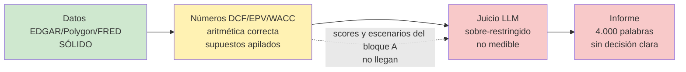

# Revisión de conjunto — 2026-10-17

**Qué es:** revisión adversarial del sistema completo tras F0 y el bloque A (ADR-042/043).

**Cómo se hizo:** seis revisiones independientes en paralelo, sin verse entre sí:
- panorama externo y evidencia publicada;
- estado del arte agéntico;
- red team de la valoración, con el diagnóstico de 33 empresas re-ejecutado;
- red team de los informes con ojos de gestor de un fondo de valor;
- arquitectura y sobreingeniería;
- medición y fiabilidad.

Las afirmaciones críticas se comprobaron contra el código y los datos antes de incluirlas. Coste de LLM: 0 $.

## 1. La foto en una frase

Los cimientos (datos y aritmética) son sólidos y la arquitectura es la correcta. **Donde se pierde el valor es en la capa de decisión y en la salida:**
- conservadurismo apilado que hace casi imposible un BUY;
- un informe largo que no dice qué hacer;
- ninguna forma de saber si el sistema acierta;
- un proceso que impide que las mejoras lleguen a la decisión.

Hemos estado puliendo las entradas mientras el cuello de botella estaba al final.

## 2. Lo que sobrevive al ataque (no tocar)

| Elemento | Por qué se mantiene | Fuente |
|---|---|---|
| Números deterministas fuera del LLM y citas validadas | El mejor agente del benchmark Vals Finance Agent acierta ~64 % leyendo filings. Calcular con código es lo que pide la evidencia, no sobreingeniería. | Investigación externa |
| Grafo fijo de LangGraph, sin bucle autónomo | Un checklist conocido es un "workflow" según la propia guía de Anthropic, y la reproducibilidad es necesaria para las evals. | Estado del arte |
| Sin MCP en el pipeline, sin vector store, sin LiteLLM | Rompen los tests offline o duplican edgartools; un 10-K cabe en contexto. | Estado del arte |
| Aritmética del DCF, puente EV→equity, SBC como coste, Altman/Beneish | Recalculados a mano KO, MSFT y AZO (más 10 tickers): cuadran al céntimo. Fórmulas correctas. | Red team de valoración |
| `verdict_policy`: el código calcula entrada, tamaño y confianza; el LLM solo puede bajar el veredicto | Es la dirección que respalda la evidencia: el LLM lee y señala, no decide. | Externo + arquitectura |
| Diagnóstico re-ejecutado el 2026-10-17 | 0 errores, sin regresiones. Mediana de las 15 empresas de calidad 0,53 (0,55 el día 11; la diferencia viene de los precios y de un Rf 12 pb menor). | Red team de valoración |

## 3. Hallazgos que importan, por impacto en la decisión

### 3.1 El BUY es prácticamente inalcanzable (confirmado)
- **El ancla.** Para las clases "average" y "cyclical" el precio de entrada sale de min(DCF, EPV) × (1 − margen 50/60 %) (`verdict_policy.py:61-79`). El EPV casi siempre es el mínimo.
- **Hoy ninguna de las 30 empresas es comprable** con esas clases.
- **El sistema suspende su propio test.** Con el precio un 40 % más bajo solo pasaría BBW, y ese test era el criterio de aceptación "ni laxo ni restrictivo" (`docs/research/2026-10-11-valuacion-por-perfiles.md:417`).
- **La causa es conservadurismo en cada capa:**
  - β = 1;
  - prima de riesgo histórica sobre un Rf actual;
  - RONIC = WACC;
  - salto de impuestos y reinversión en el terminal;
  - EPV sobre EBIT antiguo;
  - el mínimo de los dos métodos;
  - y además el margen de seguridad.

  El margen de Graham se aplica sobre una estimación central, no sobre una ya conservadora.

### 3.2 El veredicto no ha reaccionado a los números (informes anteriores a ADR-041)
- **CALM:** su DCF pasó de 205 $ a 70 $ en una semana y siguió en HOLD con un 2 % de tamaño.
- **El reparto:** 51 de los 58 análisis son HOLD, y ahí están los grandes ganadores (SNOW +141 %, QLYS +120 %).
- **Pendiente:** ADR-041 debería corregirlo, pero no existe ni un solo informe H2 que lo demuestre.

### 3.3 Los supuestos que más pesan en la valoración (confirmados)
- **EPV con EBIT en dólares de hace años** (`valuation.py:367`). Infravalora a toda empresa que crece (MSFT −26 %). Como el EPV suele fijar el precio de entrada, el sesgo va directo al veredicto.
- **"What the price implies" exagera.** Con RONIC = WACC el crecimiento posterior al año 10 no vale nada, así que el precio "implica" un 28 % para AAPL o un 22 % para KO. El Expert lo lee como "imposible, luego caro".
- **El detector de cíclicas falla en los dos sentidos:**
  - no detecta XOM, DE ni CAT;
  - con CVX sin datos asume "no cíclica", sin avisar;
  - marca como cíclicas PATH y PLUG, que pierden dinero.
- **Rupturas estructurales.** La tendencia de 10 años no las ve: refranchising en KO y MCD, la escisión de Kenvue en JNJ.
- **Banda 0,5–0,9 circular.** Mide sobre todo el tipo de descuento: el mercado paga a estas empresas una rentabilidad implícita del 5–7 % frente a un WACC del modelo del 9–10 %. Ajustar el modelo para caer en una banda definida contra el precio es circular.

### 3.4 Las mejoras no llegan a la decisión (confirmado)
- **El bloque A no llega al Expert.** Los scores contables y los escenarios no aparecen en `value_expert.py` ni en `critic.py`.
- **La causa:** cambiar el contexto del Expert exige regenerar baselines de pago, así que lo nuevo acaba solo en el markdown.
- **El formato está triplicado.** Lo mismo se formatea tres veces: `_format_context` (720 líneas), `_render_markdown` (444) y la consola (162). Es la clase de bug de EC-14/EC-17.

### 3.5 No hay forma de saber si el sistema acierta
- **La puerta de evals mide la obediencia a reglas.** Está saturada: casi todos sus checks pasan siempre.
- **El dataset es anterior a F0.** Cualquier aprobado desde entonces no significa nada.
- **Comparar contra el S&P 500** con 47 análisis tardaría entre 6 y 25 años en detectar un 5 % anual de ventaja. Sirve como registro honesto, no como señal de desarrollo.
- **Un backtest del LLM está contaminado:** el modelo ya conoce el futuro de esas fechas.
- **Lo determinista sí se podría backtestear, pero no hoy:**
  - el plan gratuito de Polygon limita el historial de precios;
  - el universo debería incluir empresas deslistadas.

### 3.6 El informe no ayuda a decidir (4/10 como herramienta de decisión)
- **Le falta lo esencial:** qué hacer y a qué precio, comparables ("¿barata frente a qué?"), la tesis diferencial y qué ha cambiado desde el análisis anterior.
- **Le sobra ruido:** unas 4.000 palabras, ~40 % noticias y apéndices. Tavily busca "calm" y trae GameStop.
- **Contradicciones internas:** un ROIC "RISING" sobre una serie que baja, y dos CAGR distintos en el mismo informe.
- **Citas que existen pero no respaldan la afirmación (MCE-31),** incluidas citas circulares de la propia salida del sistema.
- **Los rompe-tesis de las cíclicas son procíclicos:** harían vender en el suelo.
- **El checkpoint socrático no se usa:** 0 de 47 informes tienen respuestas. Los comparables se saltan siempre.

### 3.7 Higiene técnica (confirmado)
- **Filings recortados sin avisar.** Cada sección del 10-K se corta a 25.000 caracteres sin aviso (`tools/edgar.py:883`; se corta con `[:max_chars]` en varios sitios). Va contra la invariante 5.
- **Caché de prompts:** no se usa, aunque `llm/CLAUDE.md:12` lo pide.
- **Integración continua y tipos:** no hay CI ni comprobación de tipos.
- **Linter:** ruff da 55 errores (15 en `src`).
- **Código muerto:**
  - `LLMClient.complete()` (~125 líneas, con un fallback silencioso);
  - `_normalized_fcf_proxy`;
  - unos 20 campos de schema que nadie lee, incluido `gaap_vs_nongaap_flag`, que es una invariante.

### 3.8 Proceso
- **Más documentación que código:** ~2,5 MB de documentación frente a ~0,65 MB de código. Los cambios en documentación (34.000 líneas) superan a los de datos y valoración juntos (8.500).
- **El coste de cada cambio:** cada tarea exige ADR, entrada en EDGE_CASES y sección didáctica, lo que multiplica el coste del cambio. **Esto choca con un objetivo explícito tuyo (aprender y documentar), así que es una decisión tuya, no un defecto.**

## 4. La idea central: decidir por rentabilidad esperada frente a un listón explícito

Varias de las revisiones convergen en lo mismo:
- la banda 0,5–0,9 circular;
- el crecimiento implícito absurdo;
- el BUY inalcanzable;
- "¿qué listón es ni laxo ni restrictivo?".

**La propuesta.** En lugar de "valor intrínseco conservador × margen de seguridad", la cifra principal pasa a ser **la rentabilidad anual implícita a precio de hoy** con los flujos del caso base: la TIR que iguala el DCF al precio. Se compara con **un listón que eliges tú**, por ejemplo un 10 %. Es el planteamiento de Buffett y de Mauboussin y hace explícita la única elección subjetiva.

**Ejemplo.** "A 340 $, AAPL rinde un ~5 % anual si cumple su historia; tu listón es el 10 %."

**El margen de seguridad deja de apilarse.** Se expresa como la distancia entre la TIR y el listón, y como el escenario pesimista.

## 5. Plan recomendado (bloque B revisado)

| Orden | Bloque | Qué | Coste LLM | Por qué en este orden |
|---|---|---|---|---|
| B0 | Higiene (~1 día) | Borrar código muerto; ruff a 0; aviso o límite mayor en el recorte de filings; CI mínima (pytest + ruff); comprobar la latencia anómala de la BD (máx. ~16 h) | 0 | Barato y quita riesgo de regresiones |
| B1 | Capa de decisión determinista | TIR implícita frente al listón; EPV sobre margen × ventas actuales; continuidad del terminal; quitar el apilamiento min() + MOS; cíclicas sin fallos silenciosos y con test de suelo; aviso de ruptura estructural; tests de aceptación con precio ±40 % en el diagnóstico | 0 (verificable con las 33 empresas) | Es donde se pierde el valor y se puede medir gratis |
| B2 | Un solo modelo de secciones para el contexto del Expert, el informe y la consola, con el informe en una página y anexo | El bloque A llega por fin al Expert; desaparece la clase de bug EC-14 | 0 | Prepara un único cambio de contexto en lugar de muchos |
| B3 | Comparables automáticos | Competidores por SIC y tamaño, y múltiplos frente a la propia historia de 10 años | 0 | Responde a "¿barata frente a qué?"; la evidencia favorece combinar métodos |
| B4 | Medición mínima creíble | Re-congelar el dataset **una sola vez, tras B1–B3**; tests metamórficos del Expert (precio a la mitad → veredicto no peor; anonimizado → mismo veredicto); vigilar el reparto de etiquetas; rúbrica a ciegas sobre 10 informes; seguimiento contra el S&P solo como registro | ~2–5 $ en total | Re-congelar ahora sería pagar dos veces |
| B5 | Uso real | Analizar 3–5 empresas y leer los informes | ~0,1–0,5 $ | La prueba de fuego |

**Cambio respecto a lo propuesto el 2026-10-12:** no re-congelar las evals ahora. B1 y B2 cambiarán de nuevo lo que ve el Expert.

**Estado 2026-10-17:** B0–B3 implementados (ADR-044, ADR-045). B4 y B5 en espera. La deuda de la puerta está en `tests/evals/baselines/pending_gate.json`.

**Pendiente del bloque B, anotado a petición de Eduardo:**
- **B4 (necesita LLM):**
  - re-congelar el dataset de evals con el código actual;
  - pasar la puerta y regenerar las baselines;
  - borrar `pending_gate.json`;
  - tests metamórficos del Expert (precio a la mitad, anonimizado);
  - rúbrica a ciegas sobre 10 informes;
  - vigilar el reparto de etiquetas.
- **B5:** analizar 3–5 empresas reales y que Eduardo lea los informes. Hecho uno, ACMR del 2026-10-17, con los fallos que corrigió EC-112.
- **Decisiones de modelo para después de B5:**
  - prima de riesgo implícita frente al 5 % fijo;
  - RONIC del valor terminal en negocios con ventaja duradera (MCE-39);
  - rediseño del checkpoint socrático (una pregunta de tesis diferencial).
- **Necesitan datos o LLM:**
  - validación semántica de citas (MCE-31);
  - múltiplos frente a la propia historia (MCE-40);
  - backtest de la capa determinista (MCE-41).
- **Bloque C (2026-10-17):** lo determinista que no necesita evals.

## 6. Lo que NO hacer (sin evidencia, o sobreingeniería)

**Capa de LLM:**
- debate alcista/bajista o agentes "persona" (Buffett, Munger): la evidencia no muestra mejora frente a un solo modelo con el mismo cómputo;
- bucles autónomos;
- MCP en el pipeline;
- vector store;
- plataformas de evals;
- LiteLLM.

**Valoración:**
- betas por regresión o mapa SIC → industria de Damodaran;
- RONIC dependiente del moat;
- Monte Carlo y más etapas de DCF;
- capitalizar I+D;
- derivar el beneficio bruto (EC-104).

**Calibración y backtests:**
- ajustar hasta caer en una banda frente al precio;
- backtests del LLM sobre fechas anteriores a su corte de entrenamiento.

## 7. Decisiones de Eduardo (2026-10-17) y estado

1. **Listón.** Eduardo pidió la recomendación de un inversor value. Se adopta max(10 %, Rf + ERP), configurable (ADR-044).
2. **Orden.** B0 → B3 ejecutados; B4 y B5 en espera, por decisión de Eduardo. Plan: `docs/superpowers/plans/2026-10-17-bloque-b.md`.
3. **Proceso.** Consolidar y aligerar:
   - Modo Profesor por bloque;
   - un ADR por decisión;
   - EDGE_CASES en formato corto;
   - lecciones en `docs/lessons/`;
   - `mce-evolution.md` sin duplicados ni meta-herramientas.

**Recomendaciones de esta revisión que el bloque B cambió tras medirlas con datos reales:**
- **Test de valles para detectar cíclicas (S6):** descartado. Marcaba BBW, PRDO y MSFT y no detectaba XOM, DE ni CAT.
- **Usar el CAGR de 5 años cuando hay ruptura estructural (S7):** descartado; reintroducía el rebote post-COVID. Solo se avisa.
- **Pesimista de una cíclica:** no estaba en la revisión. Perpetuar un año valle dejaba sin valor a CALM; ahora sale de medias móviles de 3 años.
- **Recorte de los 10-K:** era peor de lo descrito. Además del recorte, KO y JNJ recibían secciones vacías (EC-106).

## Anexo: verificación propia de las afirmaciones críticas

- `verdict_policy.intrinsic_anchor`: min(DCF, EPV) para todo lo que no es compounder con DCF fiable. Confirmado.
- `_ebit_median`: mediana del EBIT en dólares, no margen × ventas. Confirmado.
- Recorte de filings con `[:max_chars]` y sin log: `tools/edgar.py:700, 823, 931, 971, 1013, 1050`. Confirmado. No se midió la longitud real de las secciones.
- Scores contables y escenarios: 0 referencias en `value_expert.py` y `critic.py`. Confirmado.
- β = 1,0 en 20 de los 47 informes; "Peer comparison skipped by user" en los 6 de octubre. Confirmado.
- Sin `cache_control` en el código, sin `.github/`, `_normalized_fcf_proxy` sin uso. Confirmado.
- Datos: `data/evals/valuation_diag/2026-10-17.json`; scripts del red team en el scratchpad de la sesión.
