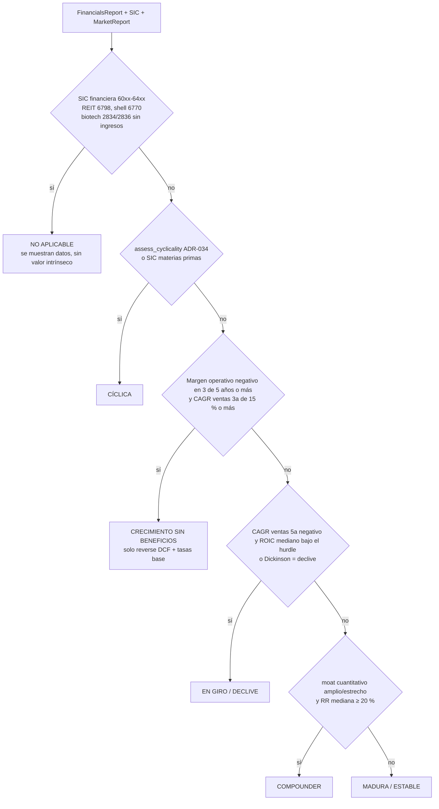

# Investigación F1: valoración diferenciada por perfil de empresa (2026-10-11)

> Entregable de la fase F1 del plan [`2026-10-11-h2v-valoracion-por-perfiles.md`](../superpowers/plans/2026-10-11-h2v-valoracion-por-perfiles.md). Es un documento de investigación, no un ADR: alimentó ADR-043 (bloque A) y ADR-044 (bloque B).
> **Estado 2026-10-17:** la valoración por perfiles (F2–F6) sigue en espera (MCE-39). La revisión de conjunto [`2026-10-17-big-picture-review.md`](../audits/2026-10-17-big-picture-review.md) cambió dos cosas de este documento: el criterio 2 (banda DCF/precio) queda retirado por circular y el listón de decisión pasa a ser una rentabilidad (ADR-044). Ver la nota en los criterios de aceptación.
> Parte del diagnóstico [`2026-10-11-valuation-diagnostic.md`](../audits/2026-10-11-valuation-diagnostic.md) y de `data/evals/valuation_diag/2026-10-11.json` (después de F0).
> Convención de fuentes: **[P]** = fuente primaria leída en esta sesión; **[S]** = fuente secundaria (resumen, blog, copia de un tercero) o primaria no verificada en el texto completo. Las cifras marcadas como **(sim.)** salen de una simulación propia sobre el JSON del diagnóstico. Sus supuestos están en el anexo A.

---

## 1. Resumen ejecutivo

1. **El 0,41 tiene dos causas.** Una parte es sesgo del modelo y otra es el precio de mercado.
   - **Sesgo del modelo:**
     - el crecimiento sale del CAGR del FCF;
     - la ventaja competitiva dura solo 10 años (5 de crecimiento + 5 de transición);
     - la beta es 1 para todas.
   - **Precio de mercado:** en enero de 2026 la prima de riesgo implícita de Damodaran era del 4,23 %, la más baja desde 2008. Con los flujos de caja del propio sistema, los precios de AAPL, MSFT, KO o JNJ implican rentabilidades de ~3–6 % (sim.).
   - Con los arreglos razonables, la mediana de calidad sube a **~0,55–0,65** (sim.), no a 1. Exigir ~1 sería ajustar el modelo al precio.
2. **Perfiles: 5 valorables y una categoría "no aplicable".** Los 5 son compounder, madura, cíclica, en giro/declive y crecimiento sin beneficios (este último solo como escenario).
   - El clasificador es determinista y usa SIC, ciclicidad (ADR-034), ROIC frente a coste de capital durante 10 años, crecimiento de ventas y signo de los flujos de caja (método de Dickinson, citado por Mauboussin).
   - Es la tipología de Damodaran por ciclo de vida, simplificada.
3. **Crecimiento.** g = ROIC normalizado × tasa de reinversión (Damodaran cap. 11), con suelo y techo. Las tasas base de Mauboussin sirven de control: la correlación del crecimiento de ventas entre periodos de 3 años es 0,16, así que no conviene extrapolar.
4. **Periodo de ventaja competitiva por perfil.** Es la palanca que menos se ha mirado y la que más mueve el resultado. Morningstar alarga la fase de transición de 1 año (sin moat) a 10–15 años o más (moat amplio). Pasar de 10 a 15 años mueve la mediana de calidad +0,08–0,10 (sim.), más que cualquier elección de tasa de descuento.
5. **Tasa de descuento (recomendación): coste de capital de mercado con beta sectorial de Damodaran, beta acotada a [0,8; 1,5] y prima de riesgo implícita actualizada cada enero.**
   - El suelo de beta da un coste de equity mínimo de ~7,6 %, casi el 7,5 % que usa Morningstar como coste de equity "por debajo de la media".
   - Una tasa fija del 10 % es la opción más restrictiva: mediana de calidad 0,42–0,44 (sim.).
6. **Moat cuantitativo.**
   - **Amplio:** ROIC por encima del coste de capital en ≥ 9 de 10 años, con un diferencial mediano ≥ 8 pp.
   - **Estrecho:** ≥ 7 de 10 años, con un diferencial mediano ≥ 2 pp.
   - **Con menos de 7 años de datos:** "indeterminado", nunca "sin moat".
   - El LLM explica el tipo de moat, pero no veta.
7. **Margen de seguridad.** El riesgo de mercado va en la tasa de descuento y la incertidumbre de la estimación en el margen. Las cíclicas ya pagan su riesgo con la normalización, así que pasar 30/50/60 a **30/40/50** evita castigar dos veces.
8. **Sistemas multiagente.** FinRobot y FinSight no eligen el método de valoración con reglas. Lo deja a un LLM o a un *Director Agent*. No hay evidencia de que eso mejore la valoración, y lo transferible es lo que el sistema ya tiene: capas datos → concepto → tesis y evaluación contra un dataset de referencia.

---

## 2. Investigación por tema

### Tema 1 — Perfiles de empresa

**Qué dicen las fuentes**

- **Damodaran: seis etapas del ciclo de vida** [P]. Son *start-up, young growth, high growth, mature growth, mature stable, decline*. La base del valor cambia con la etapa:
  - en las primeras se paga "sobre el potencial" y sobre el crecimiento;
  - en *mature growth*, el valor depende del crecimiento;
  - en *mature stable*, de los beneficios;
  - en *decline*, de los activos.
  
  Para situar a una empresa propone la edad, el sector y, sobre todo, métricas operativas: "younger companies have higher revenue growth, changing (usually rising) margins and large reinvestment" ([CLC slides](https://pages.stern.nyu.edu/~adamodar/pptfiles/CLC/CLCclassintro.pdf); libro [*The Corporate Life Cycle*, 2024](https://www.stern.nyu.edu/experience-stern/faculty-research/corporate-life-cycle-business-investment-and-management-implications)).
- **Damodaran: cíclicas y de materias primas como categoría propia** [P]. Su valor "is often more dependent on the movement of a macro variable … than it is on firm specific characteristics" ([Ups and Downs, 2009](https://pages.stern.nyu.edu/~adamodar/pdfiles/papers/commodity.pdf)).
- **Damodaran: financieras aparte** [P]. "debt for a financial service firm is more akin to raw material than to a source of capital; the notion of cost of capital and enterprise value may be meaningless", y la reinversión "may be not just difficult, but impossible, and cash flows cannot be computed" ([Valuing Financial Service Firms](https://pages.stern.nyu.edu/~adamodar/pdfiles/papers/finfirm09.pdf)).
- **Mauboussin y Callahan (abril 2026): el método depende de la etapa** [P]. "Knowing where a company is in its life cycle is essential to a thoughtful approach to valuation." Usan las cinco etapas de Gort y Klepper con la clasificación de **Dickinson**, que es determinista: la etapa sale de los signos de los flujos operativo, de inversión y de financiación ([Competitive Advantage Period](https://www.morganstanley.com/im/it-it/institutional-investor/insights/consilient-observer/the-neglected-value-driver.html)).

  | Etapa | Flujo operativo | Flujo de inversión | Flujo de financiación |
  |---|---|---|---|
  | Introducción | − | − | + |
  | Crecimiento | + | − | + |
  | Madurez | + | − | − |
  | Declive | − | + | ± |
  | *Shake-out* | Resto de combinaciones (cajón de sastre) | | |

  - **Ajustes de Mauboussin:**
    - el SBC pasa a financiación;
    - la inversión en intangibles pasa a inversión.
  - **Cobertura:** "roughly two out of three U.S. public companies are in the growth or maturity stages".
  - **Valoración por etapa:** crecimiento y madurez son "the domain of the DCF model". Introducción y declive "require some additional tools": unidad económica y TAM para las primeras; opciones de abandono y Gordon con g negativo para el declive. El ejemplo es 1/(0,07+0,06) = 7,7×.
  - **Transiciones:** el 54 % de las maduras sigue madura tres años después; el 29 % de las que están en declive vuelve a crecimiento.
- **Morningstar: un único modelo DCF de tres etapas** [P]. Lo diferencia por moat a través de la duración de la etapa II (ver Tema 3). Para financieras usa flujo para el accionista descontado al coste de equity ([Equity Research Methodology, oct. 2020](https://advisor.morningstar.com/Enterprise/VTC/MasterEquityResearchMethodology_Oct2020.pdf)).

**Conclusión para este sistema**

- **El universo de Eduardo cubre cuatro perfiles con DCF/EPV.** Son "infravaloradas, analizables, sin nicho" y encajan en compounder, madura, cíclica y en giro/declive.
- **Lo que no se cubre con DCF/EPV:**
  - **Crecimiento sin beneficios:** solo escenario y reverse DCF.
  - **Financieras, REIT y biotech sin ingresos:** "no aplicable".
- **La clasificación es determinista.** Tres señales que el sistema ya tiene o puede calcular a partir de XBRL:
  - rentabilidad y su persistencia: ROIC frente a coste de capital;
  - ciclicidad: picos de margen, ya implementado;
  - signo de los flujos de caja, como regla de desempate y para el declive.
- **El SIC solo sirve para excluir** (financieras, REIT, biotech, materias primas), no para decidir la calidad. Mauboussin muestra que "industry is not destiny": incluso las mejores industrias tienen empresas que destruyen valor ([Measuring the Moat 2016](https://www.safalniveshak.com/wp-content/uploads/2017/01/Measuring-the-Moat-Mauboussin-2016.pdf), copia de un tercero [S]).

### Tema 2 — Método por perfil

| Perfil | Qué dice la fuente | Método en el sistema |
|---|---|---|
| **Madura / estable** | Damodaran: en *mature stable* el valor descansa en los beneficios [P]. Greenwald: EPV = beneficio normalizado / coste de capital, sin crecimiento [S]. Buffett: el crecimiento "benefits investors only when the business … can invest at incremental returns that are enticing" ([carta 1992](https://www.berkshirehathaway.com/letters/1992.html)) [P]. | EPV como ancla principal, con el DCF de contraste. g pequeño, de ROIC × reinversión con techo. |
| **Compounder de calidad** | Morningstar: las empresas con moat amplio tardan 10–15 años o más en converger al coste de capital (etapa II), frente a ~1 año sin moat [P]. Mauboussin: el valor depende de la magnitud del diferencial ROIC − coste de capital, de la reinversión y de su duración (CAP) [P]. | DCF FCFF de 3 etapas con g = ROIC × reinversión y fase de transición larga (5 + 10). Más adelante, el valor terminal con RONIC que converja al ROIC del sector. |
| **Cíclica / materias primas** | Damodaran: "far better to normalize earnings and cash flows across the cycle". Normalizar también ROC, reinversión y financiación. Usar el margen medio × ventas actuales, o la media del sector si el historial es corto [P]. En materias primas, normalizar el precio de la materia prima [P]. | Lo que ya hace ADR-034 (margen mediano × ventas actuales, g = terminal), más reinversión normalizada. Pendiente el precio normalizado de la materia prima (no hay fuente primaria barata). |
| **En giro / declive** | Mauboussin: Gordon con g negativo y opciones de abandono [P]. Damodaran: en el declive, el valor descansa en los activos [P]. | EPV sin crecimiento y DCF con g negativo (CAGR de ventas). Suelo de activos (NCAV, Graham Number ya en §6.7). En dificultades → aviso y "no aplicable" si hay duda sobre la continuidad del negocio. |
| **Crecimiento sin beneficios** | Damodaran: se puede valorar con un margen objetivo de empresas maduras del sector y una probabilidad de quiebra, pero las técnicas estándar "either do not work or yield unrealistic numbers" ([Valuing Young … Companies](https://pages.stern.nyu.edu/~adamodar/pdfiles/papers/younggrowth.pdf)) [P]. | "Valor intrínseco no aplicable". Solo reverse DCF (qué crecimiento descuenta el precio) frente a tasas base. El margen objetivo es una cifra que no sale del filing de la empresa: choca con ADR-005. |
| **Financieras, REIT, biotech** | Financieras: Damodaran [P], Tema 1. REIT: la SEC indica que la mayoría reparte al menos el 100 % de su beneficio fiscal ([investor.gov](https://www.investor.gov/introduction-investing/investing-basics/investment-products/real-estate-investment-trusts-reits)) [P]. El FCFF con reinversión no describe el negocio. Biotech sin ingresos: Mauboussin propone opciones reales [P]. | "No aplicable" explícito (ver §4, decisión 3). |

### Tema 3 — Crecimiento robusto

**Qué dicen las fuentes**

- **Fórmula fundamental** [P]. "Expected Growth_EBIT = Reinvestment Rate × Return on Capital". Reinversión = (capex − amortización + Δ capital circulante no monetario) / EBIT(1−t). Damodaran añade que la tasa de reinversión del último año "is not necessarily the best estimate of the future" ([Investment Valuation, cap. 11](https://pages.stern.nyu.edu/~adamodar/pdfiles/valn2ed/ch11.pdf)).
- **La misma relación en Mauboussin** [P]. "Growth = ROIC × (1 − payout ratio)", y el ROIC es "the maximum supportable growth rate of the business excluding external financing" ([Return on Invested Capital](https://www.morganstanley.com/im/it-it/institutional-investor/insights/consilient-observer/return-on-invested-capital.html)).
- **Koller (McKinsey)** formula lo mismo como *value driver formula*: EV = NOPAT(1 − g/ROIC)/(WACC − g). No se pudo acceder a la fuente primaria (McKinsey devolvió 403) [S] ([nota técnica en research.hhs.se](https://research.hhs.se/esploro/outputs/journalArticle/Technical-Note-Value-Driver-Formulas-for/991001480420106056)).
- **El crecimiento histórico es ruidoso** [P]. Con beneficios negativos es "not meaningful" (Damodaran, cap. 11). Es la causa n.º 1 del diagnóstico: el CAGR del FCF de KO es −9 %.
- **Tasas base (Mauboussin)** [P]:
  - **Poca persistencia:** la correlación del crecimiento de ventas es "0.16 over three-year periods and 0.14 over five-year periods" (1950–2025).
  - **Las medias bajan con el tamaño:** la media a 5 años es 7,0 % para ventas de 2–5 B$ y 5,7 % para 8–12 B$ ([Bayes and Base Rates, 2026](https://www.morganstanley.com/im/it-it/institutional-investor/insights/consilient-observer/bayes-and-base-rates.html)).
  - **Matriz de transición** (exhibit 18 de CAP 2026): para cada tramo de crecimiento pasado da la distribución del crecimiento futuro. Medianas de los 3 años siguientes:

    | Crecimiento de ventas en los 3 años anteriores | Mediana en los 3 años siguientes |
    |---|---|
    | 0–4 % | 4,9 % |
    | 4–8 % | 6,3 % |
    | 8–12 % | 7,9 % |
    | 12–16 % | 9,3 % |
    | 20–24 % | 10,9 % |
    | > 44 % | 13,3 % |

    Es una tabla publicada y determinista, utilizable como control.
- **Crecimiento terminal** [P].
  - **Damodaran:** "the stable growth rate cannot exceed the growth rate of the economy" y puede ser menor (cap. 12).
  - **Mauboussin:** "expected inflation is a sensible way to model long-term growth".
  - El 2,5 % actual es coherente con ambas.
- **Duración del crecimiento** [P].
  - **Damodaran:** la duración del periodo de alto crecimiento depende sobre todo de las barreras de entrada. En el periodo estable, suponer cero rendimientos en exceso es una opción, pero "it is difficult in practice to assume that firms will suddenly lose the capacity to earn excess returns". Recomienda que el ROIC se acerque a la media de la industria (cap. 12).
  - **Morningstar:** la etapa II dura "anywhere from one year (for companies with no economic moat) to 10-15 years or more (for wide-moat companies)" (metodología 2020).
  - **Mauboussin:** el ROIC revierte a la media a ritmos distintos por sector, con correlaciones a 5 años de 0,59 en consumo básico y ~0,16–0,18 en los últimos sectores. Recomienda usar la correlación a 5 años como base del ritmo de convergencia (CAP 2026, exhibit 10).

**Conclusión para este sistema**

- **Regla de crecimiento:** `g1 = clamp(ROIC_norm × RR_norm, suelo, techo)`.
  - **ROIC_norm:** mediana de ≤ 5 años.
  - **RR_norm:** mediana de la tasa de reinversión en 3–5 años.
- **Suelo:** el g terminal (2,5 %) para compounder y madura con ROIC > coste de capital y ventas sin caída. Sin suelo para el declive.
- **Techo:** el menor entre el CAGR de ventas de 10 años + 2 pp y el 15 %.
- **Control con tasas base (aviso, no ajuste):** si `g1` supera el percentil 75 de la matriz de Mauboussin para su tramo, el informe lo indica.
- **Duración:** fase de transición de 10 años para compounder con moat amplio (5 + 10); 5 + 5 para el resto.
- **Valor terminal:** se mantiene RONIC = WACC. Es prudente, y la generosidad ya entra por la duración.

### Tema 4 — Tasa de descuento (la decisión clave)

**Qué dice cada fuente**

| Enfoque | Fuente | Contenido |
|---|---|---|
| **WACC de mercado con beta sectorial** | Damodaran [P] | Betas por industria de enero 2026 ([Betas](https://pages.stern.nyu.edu/~adamodar/New_Home_Page/datafile/Betas.html)). Coste de capital por industria ([wacc](https://pages.stern.nyu.edu/~adamodar/New_Home_Page/datafile/wacc.html)): mercado total 6,96 %, sin financieras 7,72 %, bebidas 6,33 %, productos del hogar 7,03 %, farmacéuticas 7,85 %, software 9,34 %, ordenadores 9,71 %. Prima de riesgo implícita a 1 de enero de 2026 = **4,23 %** con T-bond del 4,18 % ([histimpl](https://pages.stern.nyu.edu/~adamodar/New_Home_Page/datafile/histimpl.html)). Media 1961–2025 = 4,25 %; mínimo desde 2008 = 4,23 %. |
| | Mauboussin [P] | La prima de riesgo de Damodaran le resulta "useful", y recomienda "calculate the cost of capital based on market prices for risk" (CAP 2026). |
| **Tasa fija tipo Buffett** | Buffett [P] | La tasa es el bono largo del Tesoro: "What is the risk-free interest rate (which we consider to be the yield on long-term U.S. bonds)?" ([carta 2000](https://www.berkshirehathaway.com/letters/2000pdf.pdf)). El riesgo va en el margen de seguridad: "we insist on a margin of safety … the cornerstone of investment success" ([carta 1992](https://www.berkshirehathaway.com/letters/1992.html)). |
| | Buffett [S] | El "10 %" sale de la junta de 1994, con bonos al ~7 %: no es una tasa fija, sino ~bono + 3 pp ([25iq](https://25iq.com/2015/11/21/why-and-how-do-munger-and-buffett-discount-the-future-cash-flows-at-the-30-year-u-s-treasury-rate/); [Advisor Perspectives](https://www.advisorperspectives.com/commentaries/2013/10/04/what-is-the-correct-discount-rate-to-use-part-2b)). |
| **Híbrido por categorías** | Morningstar [P] | Coste de equity por bloques, "minimizing the effects of recency bias, false precision, and market noise". Rentabilidad real esperada del mercado 6,5–7 % + inflación 2–2,5 % + prima sistemática en 4 categorías: **7,5 % / 9 % / 11 % / 13,5 %** (betas implícitas 0,67 / 1,0 / 1,44 / 2,0; prima 4,5 %, libre de riesgo 4,5 %). |

**Efectos según el tipo de empresa**

- **Beta sectorial y defensivas.**
  - **Defensivas:** la beta sectorial baja su tasa (KO 8,6 % → ~7,0 %), que es lo que pedía la causa 4 del diagnóstico.
  - **Tecnológicas grandes:** se la sube (AAPL 9,1 % → 9,6–10,6 %, GOOGL → 9,8–10,8 %).
- **Riesgo con las cíclicas de materias primas.**
  - **El problema:** la beta de regresión es baja (petroleras integradas 0,30, con solo 4 empresas en la muestra) y daría tasas del ~5 %. Un inversor value las percibe como más arriesgadas, no menos.
  - **Qué dice Damodaran:** en estado estable, las betas no deberían superar 1,2, y para las de materias primas con beta < 1 "there is no harm" en mantenerla si siguen en su negocio (cap. 12).
  - **Conclusión:** sin suelo, la beta sectorial **favorece** a las cíclicas, y eso hay que corregirlo.
- **Tasa fija del 10 %.**
  - **Todos los perfiles igual:** trata del mismo modo a KO y a AAPL, que es lo que se quiere corregir.
  - **Prima implícita alta:** con el bono al 4,2 %, supone una prima del ~5,8 % para todos, muy por encima de la implícita actual (4,23 %).
  - **Lejos de Buffett:** no es literalmente lo que dice Buffett (bono + margen).

**Efecto numérico estimado (sim., mediana DCF/precio de las 15 de calidad; hoy = 0,41)**

| Escenario | Transición 10 años (5+5) | 15 años (5+10) |
|---|---|---|
| Solo arreglar g (suelo 2,5 %), WACC actual | 0,50 | 0,53 |
| g con suelo + WACC sectorial de Damodaran | 0,52 | 0,62 |
| g con suelo + **beta sectorial acotada [0,8; 1,5], prima 4,23 %** (recomendado) | **0,54** | **0,61** |
| Igual, con la prima de 5,0 % del código actual | 0,49 | 0,56 |
| g con suelo + máx(WACC sectorial; 8 %) | 0,52 | 0,55 |
| g con suelo + tasa fija del 10 % | 0,42 | 0,44 |
| Máximo razonable (g 8 %, WACC sectorial, transición 20 años, RONIC 2× WACC) | 0,99 (20 años) | — |

**Lectura de la tabla**

1. **La tasa de descuento mueve la mediana ±0,1.** El crecimiento y la duración la mueven más.
2. **Aun con los supuestos más generosos, la mediana apenas llega a 1.** Con los flujos de caja del sistema, los precios de octubre de 2026 implican rentabilidades medianas del **~5 %** (sim.) para estas 15 empresas, frente a un coste de equity de mercado del 8,02 % (Damodaran, enero 2026). Varias quedan por debajo del 3,5 %: AAPL, MSFT, KO, JNJ.
3. **El sesgo no se ha resuelto por completo:** el FCFF de MSFT y GOOGL está deprimido por el capex en IA (el propio Mauboussin estudia este caso). Pero buena parte del 0,41 es una **lectura correcta de un mercado caro**.

**Conclusión: recomendación de tasa de descuento**

- **Coste de equity:** `Ke = Rf + clamp(β_L sector, 0,8, 1,5) × ERP_implícita_enero`.
- **WACC:** con los pesos y el Kd sintético actuales (ADR-033).
- **Mínimo efectivo:** el suelo 0,8 da un coste de equity de 4,18 % + 0,8 × 4,23 % ≈ **7,6 %**, prácticamente el 7,5 % "below average" de Morningstar (una segunda fuente primaria que lo respalda).
- **Techo de beta en 1,5:** evita que la tecnología salga castigada por betas de regresión volátiles.
- **Muestras pequeñas:** industrias con < 10 empresas usan la beta del mercado sin financieras (0,99).
- **Sin prima de tamaño:** se contaría dos veces (ADR-033).
- **Por qué es "ni laxo ni restrictivo":**
  - defensivas y tecnológicas dejan de recibir la misma tasa;
  - las cíclicas no se benefician de betas bajas;
  - la referencia es la del mercado, actualizada una vez al año (sin ruido diario);
  - el riesgo propio de cada empresa se queda en el margen de seguridad (Tema 6).

### Tema 5 — Moat cuantitativo

**Qué dicen las fuentes**

- **Morningstar** [P]:
  - **Definición:** el moat es "a structural feature that allows a firm to sustain excess profits over a long period of time". Exceso = ROIC por encima del WACC.
  - **Estrecho:** "more likely than not to achieve normalized excess returns for at least the next 10 years".
  - **Amplio:** "very high confidence … for 10 years, … more likely than not … at least 20 years".
  - **Cinco fuentes:** intangibles, costes de cambio, efecto red, ventaja en costes y escala eficiente.
- **Mauboussin** [P]:
  - **Ventaja competitiva:** exige dos cosas, rendimientos por encima del coste de capital y por encima de los competidores.
  - **Reversión a la media:** es tanto más rápida cuanto más volátil es el ROIC ("If CFROIs are volatile … regression toward the mean is rapid") (Measuring the Moat 2016 [S]; edición de octubre de 2024 [P]: [Counterpoint](https://www.morganstanley.com/im/publication/insights/articles/article_measuringthemoat.pdf)).
  - **Lo que más distingue a las empresas que sostienen ROIC alto es el margen NOPAT** ("2.8 times the median"), más que la rotación (CAP 2026).
- **Damodaran** [P]: existe "a surprising degree of persistence in historical returns" en el corto plazo, pero la media a largo plazo es menos fiable que el marginal ([Return measures](https://pages.stern.nyu.edu/~adamodar/pdfiles/papers/returnmeasures.pdf)).
- **Greenwald** [S] (*Value Investing: From Graham to Buffett and Beyond*, vía resúmenes: [Buteau](https://www.antoinebuteau.com/lessons-from-bruce-greenwald/), [Old School Value](https://www.oldschoolvalue.com/?p=2317)): la franquicia existe cuando el EPV supera el valor de reproducción de los activos. Sin barreras, la competencia lleva los rendimientos al nivel que justifica la inversión en activos.
  - **Equivalencia algebraica (propia):** si se aproxima el valor de reproducción con el capital invertido contable, EPV/IC = (NOPAT/WACC)/IC = **ROIC/WACC**. La prueba de Greenwald equivale a ROIC > WACC sostenido.
  - **Advertencia:** el IC contable infravalora la reproducción en negocios intensivos en intangibles. Mauboussin ajusta el ROIC por intangibles y observa que los extremos "regress toward the mean".

**Regla determinista propuesta (umbrales a calibrar con datos reales antes de escribir código, como se hizo en ADR-034)**

```text
datos   = roic_series de los últimos ≤ 10 ejercicios; hurdle = WACC de la empresa (Tema 4)
cobertura < 7 años              → moat = "indeterminado"  (no "none": AAPL tiene hoy 3 puntos en algunos estados)
spread_i = ROIC_i − hurdle;  años_ok = #(spread_i > 0);  spread_med = mediana(spread_i)
amplio   : años_ok ≥ 9 de 10  y spread_med ≥ 8 pp  y no cíclica (ADR-034)  y CV(margen operativo) ≤ 0,25
estrecho : años_ok ≥ 7 de 10  y spread_med ≥ 2 pp
ninguno  : resto
ROIC con IC ≤ 0 o ROIC > 100 % → año "n/m"; cuenta como cobertura y se resuelve con margen operativo estable
```

**Justificación de los umbrales**

- **7 y 9 de 10 años:** son la traducción histórica de "más probable que no" y "alta confianza" de Morningstar.
- **2 pp:** filtra el ruido de medida del WACC.
- **8 pp:** se aproxima a los "spreads" de empresas con ventaja duradera de Mauboussin. Es una propuesta y hay que calibrarla.
- **Estabilidad del margen:** recoge la observación de Mauboussin de que la volatilidad acelera la reversión.

**Rol del LLM**

- **Qué aporta:** el tipo de moat (taxonomía del checklist §2.1) y la explicación.
- **Desacuerdo:** si contradice al código, se muestra el desacuerdo.
- **Límite:** no puede pasar de "indeterminado" o "ninguno" a "amplio".

**Riesgo detectado en los datos**

- En `data/evals/specialists/gpt-4o-mini/AAPL-base.state.json`, `roic_series` tiene 3 puntos: FY2025 = 2,725 (272 %), FY2017 y FY2016.
- Por la regla MCE-26 hay que verificar con datos vivos antes de calibrar. Es un estado antiguo y quizá esté ya corregido.

### Tema 6 — Margen de seguridad y doble penalización

**Qué dicen las fuentes**

- **Morningstar** [P]: el margen exigido sale de la **incertidumbre** de la estimación (escenarios alcista y bajista con probabilidad del 25 % cada uno), no de la calidad del negocio. "the more uncertain we are … the greater the discount we require". Las bandas exactas por nivel no se verificaron en el documento primario (aparecen en un gráfico).
  - **Ejemplo** [S]: un artículo de Morningstar sitúa KO en ±20–25 % y lo más incierto cerca del 50 % ([morningstar.ca](https://www.morningstar.ca/ca/news/227342/what-is-the-morningstar-uncertainty-rating.aspx)).
- **Buffett** [P]: tasa libre de riesgo y margen de seguridad. El riesgo **no** va en la tasa.
- **Checklist §9.1 y ADR-041:** 30 / 50 / 60 por tipo de negocio.

**Dónde está la doble penalización hoy**

- Una cíclica ya recibe un flujo normalizado a la mediana (ADR-034) y un g terminal.
- A eso se le añade el 60 % de margen y el ancla mín(DCF, EPV).
- Si además se le subiera la tasa, pagaría el mismo riesgo tres veces.
- Lo mismo para "sin moat" (12 de 13 en el dataset): 50 % de margen y mín(DCF, EPV) por un juicio del LLM, no por un dato.

**Conclusión**

- **Una sola vía para cada tipo de riesgo:**
  - **Riesgo sistemático:** en la tasa de descuento (beta sectorial acotada).
  - **Ciclo:** en los flujos (normalización).
  - **Incertidumbre de la estimación:** en el margen.
- **Margen propuesto:**
  - **Compounder:** 30 %.
  - **Madura:** 40 %.
  - **Cíclica:** 50 %.
  - **En giro/declive:** 50 %, con ancla EPV o activos.
- **Ampliación posible:** cuando DCF y EPV discrepen más de 2× (dispersión alta, Morningstar), sumar 10 pp. Eso convierte el margen en una medida de incertidumbre y no de prejuicio, sin escenarios ni Monte Carlo (YAGNI).

### Tema 7 — Sistemas multiagente

**FinRobot (Zhou et al., 2024)** [P] ([arXiv 2411.08804](https://arxiv.org/html/2411.08804v1))

- **Estructura:** tres agentes CoT en cadena fija (Data-CoT → Concept-CoT → Thesis-CoT).
- **Valoración:** promete "industry-appropriate valuation metrics", pero el mecanismo es el propio LLM. Las proyecciones "are integrated into valuation models, such as the Discounted Cash Flow (DCF) or Price-to-Earnings (P/E) ratio models".
- **Evaluación:** en un único caso (Waste Management), con GPT-4 puntuando y 7 revisores. No hay reglas de enrutado por tipo de empresa.

**FinRobot plataforma (Yang et al., 2024)** [P] ([arXiv 2405.14767](https://arxiv.org/html/2405.14767v2))

- **Quién elige:** un *Smart Scheduler* con un *Director Agent* que "evaluates task inputs, ranking agents by performance" y "routes tasks to the highest-ranked agent".
- **Con qué criterio:** puntuaciones contra un *golden dataset*. Elige **qué modelo o agente**, no qué método de valoración.

**FinSight (Jin et al., 2025; ACL 2026)** [P] ([arXiv 2510.16844](https://arxiv.org/html/2510.16844v1))

- **Cómo funciona:** un agente de código con memoria de variables "dynamically deciding when to process data, invoke data collection workflows, or terminate".
- **Valoración:** no hay ninguna regla ni elección de método. Se evalúa la calidad del informe en 20 casos frente a informes de bróker.

**Qué se puede transferir sin un supervisor LLM**

1. **La separación datos → concepto → tesis.** Ya existe (especialistas → Value Expert).
2. **Evaluar contra un dataset de referencia** antes de cambiar modelo o prompt. Ya existe (ADR-038).
3. **"Industry-appropriate" como idea, no como mecanismo:** en este sistema lo resuelve un clasificador determinista. Ninguno de los dos papers aporta evidencia de que la elección por LLM valore mejor. Mauboussin (Dickinson) y Damodaran sí aportan reglas deterministas para el ciclo de vida.

**Qué no se transfiere**

- Ni el *Director Agent* ni la decisión dinámica de FinSight: chocan con "nada de supervisor LLM" y con la capacidad de testear.

---

## 3. Propuesta concreta: tabla de perfiles



| Perfil | Reglas de clasificación (deterministas) | Valoración | Crecimiento g1 | Duración (etapa 1 + transición) | Descuento | Ancla del veredicto | Margen |
|---|---|---|---|---|---|---|---|
| **Compounder** | Moat cuantitativo amplio o estrecho (Tema 5). Tasa de reinversión mediana ≥ 20 % del NOPAT. No cíclica. | DCF FCFF 3 etapas + EPV | clamp(ROIC×RR; 2,5 %; mín(CAGR ventas 10 años + 2 pp; 15 %)). Aviso si > P75 de las tasas base. | 5 + 10 (moat amplio); 5 + 5 (estrecho) | WACC con β sectorial acotada | DCF si TV ≤ 75 % y DCF/EPV ≤ 2,5. Si no, rango DCF–EPV y mín. | 30 % |
| **Madura / estable** | ROIC ≥ hurdle en ≥ 5 de 10 años, sin moat cuantitativo o con RR < 20 %. No cíclica. Ventas sin caída. | EPV principal + DCF de contraste | clamp(ROIC×RR; 0; 5 %) | 5 + 5 | Ídem | Media(EPV, DCF) si discrepan ≤ 1,5×. Si no, mín. | 40 % |
| **Cíclica / materias primas** | ADR-034 (pico ≥ 8 pp y ≥ 1,75× la mediana) o SIC 10xx, 12xx, 13xx, 2911, 287x, 331x, 01xx | Mitad de ciclo (ADR-034) + reinversión normalizada | = g terminal | — | Ídem (el suelo de β evita tasas del ~5 %) | mín(DCF normalizado, EPV normalizado) | 50 % |
| **En giro / declive** | CAGR de ventas 5 años < 0 y ROIC mediano < hurdle, o Dickinson = declive en 2 de 3 años | EPV + suelo de activos (NCAV, valor contable tangible) | CAGR de ventas 5 años (negativo permitido; suelo −10 %) | 0 + 5 | Ídem | mín(EPV, DCF); suelo NCAV informativo | 50 % |
| **Crecimiento sin beneficios** | Margen operativo < 0 en ≥ 3 de 5 años y CAGR de ventas 3 años ≥ 15 % | **Sin valor intrínseco.** Reverse DCF frente a tasas base de Mauboussin. | — | — | — | Ninguna → nunca BUY (WATCHLIST/PASS) | — |
| **No aplicable** | SIC 6000–6499 (bancos, aseguradoras, brókeres), 6798 (REIT), 6770 (SPAC/shells) y biotech (2834/2836) sin ingresos | No se valora. Se muestran métricas con el aviso "método no aplicable". | — | — | — | Ninguna | — |

**Precedencia:** no aplicable > cíclica > crecimiento sin beneficios > declive > compounder > madura. El LLM solo desempata cuando el código marca "frontera", es decir, a ±1 año de un umbral.

**Notas**

- **V y MA** tienen SIC 7389 (servicios), no financiero: se valoran.
- **El mapeo SIC → industria de Damodaran** necesita su lista de empresas por industria (dataset público "indname"; no verificado en esta sesión).
- **Riesgo de mapeo:** el mapeo es una fuente de error. Si se mapea mal (por ejemplo V o MA a "Financial Svcs." con D/E del 272 %), el WACC sale del 5 %.

---

## 4. Decisiones que debe tomar Eduardo

### Decisión 1 — Tasa de descuento

| Opción | A favor | En contra |
|---|---|---|
| **A. WACC de mercado con beta sectorial de Damodaran, sin suelo** | Estándar académico (Damodaran, Mauboussin). Diferencia defensivas y tecnológicas. | Las cíclicas con beta baja reciben ~5 %. La referencia cambia con el mercado: sistema relativo, no absoluto. |
| **B. Tasa fija del 10 % (estilo "Buffett")** | Simple, estable, exigente. | Iguala KO y AAPL. Es la más restrictiva (mediana 0,42–0,44, sim.). No es lo que dice Buffett en la fuente primaria (bono + margen de seguridad). |
| **C. Híbrido: beta sectorial acotada [0,8; 1,5], prima implícita revisada en enero** | Diferencia por sector sin premiar a las cíclicas. El suelo efectivo (~7,6 %) coincide con el 7,5 % de Morningstar. Mediana 0,54–0,61 (sim.). | Hay que mantener un dataset anual y el mapeo SIC → industria. |
| C'. Como C con prima del 5,0 % (la del código actual) | Más conservadora (0,49–0,56). | Mezcla una prima histórica con un tipo actual. Damodaran usa la implícita. |

**Recomendación: C.** Si Eduardo quiere un margen extra, mejor C' que B.

### Decisión 2 — Lista de perfiles

| Opción | A favor | En contra |
|---|---|---|
| **A. 5 valorables + "no aplicable"** (tabla §3) | Cubre su universo. Cada perfil tiene un método distinto y justificado. | Cinco paquetes de reglas para el Expert (F5). |
| B. 4: fusionar madura y compounder (la diferencia queda solo en la duración y el margen) | Menos ramas. | Se pierde la diferencia de ancla (EPV frente a DCF), que es justo la lección de Greenwald. |
| C. 6: separar "materias primas" de "cíclica industrial" | Más fiel a Damodaran (precio normalizado de la materia prima). | Sin precios normalizados de materias primas de fuente primaria, el método sería igual. YAGNI. |

**Recomendación: A.** Crecimiento sin beneficios entra como perfil "sin valor intrínseco", no como valoración.

### Decisión 3 — Qué es "no aplicable"

| Opción | A favor | En contra |
|---|---|---|
| **A. Bancos, aseguradoras y brókeres (SIC 60–64), REIT (6798), SPAC/shells (6770), biotech sin ingresos** | Respaldado por Damodaran (financieras) y por la SEC (REIT). Pocos casos en el universo value. | Se excluyen bancos baratos clásicos (P/B < 1). |
| B. A + utilities reguladas | Su ROE lo fija el regulador. | Damodaran y Morningstar las valoran con DCF/DDM. El sistema puede hacerlo como "madura". |
| C. Valorar financieras con P/B frente a ROE ("excess return model" de Damodaran) | Abre los bancos. | Es un método nuevo, con datos XBRL distintos (capital regulatorio). Fuera de YAGNI ahora. |

**Recomendación: A.** C queda anotado en `mce-evolution.md` con un trigger: "Eduardo pide analizar un banco".

### Decisión 4 — Umbrales del moat

| Opción | A favor | En contra |
|---|---|---|
| **A. 9 de 10 años + 8 pp (amplio) / 7 de 10 + 2 pp (estrecho) / < 7 años = indeterminado** | Equivale a la definición de Morningstar sobre historia. Determinista. | Los umbrales en pp son propuestas: hay que calibrarlos con 10 años de ROIC del universo del diagnóstico antes de escribir código. |
| B. Solo años por encima (sin diferencial mínimo) | Más sencillo. | Un ROIC de WACC + 0,1 pp contaría como moat. |
| C. Moat del LLM (actual) | Recoge lo cualitativo. | 12 de 13 "sin moat": demasiado severo y no reproducible. |

**Recomendación: A**, con el LLM como explicación y la regla de que no puede subir el moat.

### Decisión 5 — Duración de la ventaja y margen de seguridad (se deciden juntas)

| Opción | A favor | En contra |
|---|---|---|
| **A. Transición de 10 años para compounder con moat amplio; margen 30/40/50/50** | Morningstar (etapa II de 10–15 años o más). Elimina la doble penalización. | Mayor valor para compounders: depende de que el moat cuantitativo esté bien calibrado. |
| B. Dejar 5 + 5 y 30/50/60 | Conservador, ya en ADR-041. | Mantiene las dos causas del "nunca hay oportunidad" en negocios buenos. |

**Recomendación: A.** Exige actualizar el checklist §9.1 y escribir un ADR que modifique ADR-041.

---

## 5. Riesgos (laxo frente a restrictivo) y cómo medirlos

**Demasiado laxo**

- **Qué lo provoca:**
  - g alto sin respaldo de reinversión;
  - transiciones largas para negocios sin moat real;
  - beta baja en cíclicas;
  - datos erróneos (V y MA antes de F0).
- **Cómo se nota:** DCF/precio > 2 sin explicación. Hoy, BBW 3,99, VZ 2,41 y KBR 2,11, con g sacado del CAGR del FCF.

**Demasiado restrictivo**

- **Qué lo provoca:**
  - CAGR negativo extrapolado;
  - moat "ninguno" por falta de datos;
  - tasa fija alta;
  - margen exigido sobre un riesgo ya descontado.
- **Cómo se nota:** cero BUY posibles incluso con precios un 40 % más bajos.

**Criterios de aceptación verificables con `scripts/valuation_diagnostic.py`**

> **Nota 2026-10-17 (ADR-044).** El criterio 2 queda **retirado**: una banda de DCF/precio mide sobre todo el tipo de descuento y ajustar el modelo hasta caer en ella calibra contra el propio precio (revisión de conjunto, S2). Los criterios 4 y 5 se mantienen, pero sobre el nuevo precio de entrada (rentabilidad base ≥ listón y pesimista ≥ Rf). Con el listón del 10 % y el mercado de octubre de 2026 (calidad a 40–50 veces su FCFF, rentabilidad implícita del 4–8 %), el 60 % del criterio 4 no se alcanza: un −40 % no lleva esas empresas al 10 %. No es un fallo del modelo, es lo que significa exigir la rentabilidad histórica del mercado. El diagnóstico publica el recuento como alarma, no como objetivo.

1. **Agrupar por perfil del clasificador** (no por listas hechas a mano) y publicar por perfil la mediana de DCF/precio, EPV/precio, la rentabilidad implícita y el % de BUY potenciales.
2. **Compounder + madura:** mediana DCF/precio en **[0,5; 0,9]** con los precios de octubre de 2026.
   - No es un objetivo de precio: es la banda que deja la simulación con supuestos razonables.
   - Fuera de la banda hay que explicarlo con una cifra: g, duración, WACC o rentabilidad implícita.
3. **Explicación de los extremos:** el 100 % de los casos con DCF/precio < 0,5 o > 2 muestra el supuesto dominante y la rentabilidad implícita a precio de mercado.
4. **Prueba metamórfica de no restricción:** con el precio un 40 % más bajo, al menos el 60 % de compounders y maduras con moat cuantitativo debe quedar en o por debajo del precio de entrada. Si no, el sistema es incapaz de ver oportunidades en negocios buenos.
5. **Prueba metamórfica de no laxitud:** con el precio un 40 % más alto, ningún BUY.
6. **Coherencia DCF/EPV:** ≤ 2,5× en el ≥ 80 % de las valorables. El resto, con rango.
7. **"No aplicable":** ≤ 15 % del universo del diagnóstico, y 100 % de los bancos y REIT añadidos a propósito (añadir 2–3: JPM, O, VRTX).
8. **Sensibilidad:** ±1 pp de WACC cambia la mediana de calidad en ≤ 0,15. Si cambia más, el valor terminal domina (TV > 75 %).
9. **Tasa de BUY potenciales:**
   - 0 de 33 → probablemente restrictivo;
   - > 35 % → probablemente laxo (en un mercado con prima implícita del 4,2 %).
   - Funciona como alarma, no como objetivo.

---

## 6. Fuentes

| # | Fuente | Tipo |
|---|---|---|
| 1 | Damodaran, *Betas by Sector (US)*, enero 2026 — https://pages.stern.nyu.edu/~adamodar/New_Home_Page/datafile/Betas.html | P |
| 2 | Damodaran, *Cost of Equity and Capital (US)*, enero 2026 — https://pages.stern.nyu.edu/~adamodar/New_Home_Page/datafile/wacc.html | P |
| 3 | Damodaran, *Historical Implied Equity Risk Premiums*, enero 2026 — https://pages.stern.nyu.edu/~adamodar/New_Home_Page/datafile/histimpl.html | P |
| 4 | Damodaran, *The Corporate Life Cycle* (diapositivas) — https://pages.stern.nyu.edu/~adamodar/pptfiles/CLC/CLCclassintro.pdf | P |
| 5 | Página del libro *The Corporate Life Cycle* (NYU Stern) — https://www.stern.nyu.edu/experience-stern/faculty-research/corporate-life-cycle-business-investment-and-management-implications | P (ficha) |
| 6 | Damodaran, *Ups and Downs: Valuing Cyclical and Commodity Companies* (2009) — https://pages.stern.nyu.edu/~adamodar/pdfiles/papers/commodity.pdf | P |
| 7 | Damodaran, *Valuing Financial Service Firms* — https://pages.stern.nyu.edu/~adamodar/pdfiles/papers/finfirm09.pdf | P |
| 8 | Damodaran, *Return on Capital, ROIC and ROE* — https://pages.stern.nyu.edu/~adamodar/pdfiles/papers/returnmeasures.pdf | P |
| 9 | Damodaran, *Investment Valuation*, cap. 11 "Estimating Growth" — https://pages.stern.nyu.edu/~adamodar/pdfiles/valn2ed/ch11.pdf | P |
| 10 | Damodaran, *Investment Valuation*, cap. 12 "Closure in Valuation" — https://pages.stern.nyu.edu/~adamodar/pdfiles/valn2ed/ch12.pdf | P |
| 11 | Damodaran, *Valuing Young, Start-up and Growth Companies* (2009) — https://pages.stern.nyu.edu/~adamodar/pdfiles/papers/younggrowth.pdf | P |
| 12 | Mauboussin y Callahan, *Competitive Advantage Period: The Neglected Value Driver* (abril 2026) — https://www.morganstanley.com/im/it-it/institutional-investor/insights/consilient-observer/the-neglected-value-driver.html (PDF: …/consilient-observer/article_theneglectedvaluedriver_ltr.pdf) | P |
| 13 | Mauboussin y Callahan, *Bayes and Base Rates* (febrero 2026) — https://www.morganstanley.com/im/it-it/institutional-investor/insights/consilient-observer/bayes-and-base-rates.html | P |
| 14 | Mauboussin y Callahan, *Return on Invested Capital* (2022, ed. 2025) — https://www.morganstanley.com/im/it-it/institutional-investor/insights/consilient-observer/return-on-invested-capital.html | P |
| 15 | Mauboussin y Callahan, *Measuring the Moat* (octubre 2024) — https://www.morganstanley.com/im/publication/insights/articles/article_measuringthemoat.pdf | P |
| 16 | Mauboussin et al., *Measuring the Moat* (Credit Suisse, 2016), copia de un tercero — https://www.safalniveshak.com/wp-content/uploads/2017/01/Measuring-the-Moat-Mauboussin-2016.pdf | S (copia) |
| 17 | Serie *Consilient Observer* (índice) — https://www.morganstanley.com/im/it-it/institutional-investor/insights/series/consilient-observer.html | P |
| 18 | Morningstar, *Equity Research Methodology* (23 de octubre de 2020) — https://advisor.morningstar.com/Enterprise/VTC/MasterEquityResearchMethodology_Oct2020.pdf | P |
| 19 | Morningstar, metodología 2023 (403, no leída) — https://s205.q4cdn.com/437373358/files/doc_downloads/2025/07/Morningstar-Equity-Research-Methodology-2023-06-14.pdf | — |
| 20 | Morningstar, *What is the Morningstar Uncertainty Rating?* (contenido no descargado; cifras vía buscador) — https://www.morningstar.ca/ca/news/227342/what-is-the-morningstar-uncertainty-rating.aspx | S |
| 21 | Buffett, carta a los accionistas de 1986 (*owner earnings*) — https://www.berkshirehathaway.com/letters/1986.html | P |
| 22 | Buffett, carta de 1992 (crecimiento y valor, margen de seguridad) — https://www.berkshirehathaway.com/letters/1992.html | P |
| 23 | Buffett, carta de 2000 (Esopo, tasa libre de riesgo) — https://www.berkshirehathaway.com/letters/2000pdf.pdf | P |
| 24 | Junta de Berkshire de 1994, el "10 %" (resúmenes) — https://25iq.com/2015/11/21/why-and-how-do-munger-and-buffett-discount-the-future-cash-flows-at-the-30-year-u-s-treasury-rate/ ; https://www.advisorperspectives.com/commentaries/2013/10/04/what-is-the-correct-discount-rate-to-use-part-2b | S |
| 25 | Greenwald, EPV y valor de reproducción (resúmenes del libro) — https://www.antoinebuteau.com/lessons-from-bruce-greenwald/ ; https://www.oldschoolvalue.com/?p=2317 | S |
| 26 | Koller y McKinsey, *value driver formula* (McKinsey 403; nota técnica) — https://research.hhs.se/esploro/outputs/journalArticle/Technical-Note-Value-Driver-Formulas-for/991001480420106056 | S |
| 27 | *The Base Rate Book* (Credit Suisse 2016), resumen — https://hedgefundalpha.com/education/michael-mauboussin-the-base-rate-book/ | S (sustituida por #12–13) |
| 28 | Zhou et al., *FinRobot: AI Agent for Equity Research and Valuation* — https://arxiv.org/html/2411.08804v1 | P |
| 29 | Yang et al., *FinRobot: An Open-Source AI Agent Platform* — https://arxiv.org/html/2405.14767v2 | P |
| 30 | Jin et al., *FinSight: Towards Real-World Financial Deep Research* — https://arxiv.org/html/2510.16844v1 (ACL 2026: https://aclanthology.org/2026.acl-long.265/) | P |
| 31 | SEC / investor.gov, *Real Estate Investment Trusts* — https://www.investor.gov/introduction-investing/investing-basics/investment-products/real-estate-investment-trusts-reits | P |

---

## Anexo A — Supuestos de la simulación (sim.)

- **Datos:** `data/evals/valuation_diag/2026-10-11.json` (después de F0). Las 15 de calidad son AAPL, MSFT, GOOGL, V, MA, COST, ORLY, AZO, ADP, MCD, KO, PEP, PG, JNJ y HD. La línea base reproduce la mediana actual de 0,41.
- **Modelo:** el mismo DCF de 3 etapas que `valuation_math.dcf_components`:
  - fase de transición lineal hasta g = 2,5 %;
  - valor terminal NOPAT(1+g)(1−g/RONIC) con RONIC = WACC.
  
  Se calcula el cociente de valor nuevo/actual y se aplica al DCF/precio actual.
- **Aproximaciones:**
  - **Equity ≈ EV:** en empresas apalancadas el equity se mueve más que el EV.
  - **NOPAT base ≈ FCFF base.**
  - **Sin capitalización a la fecha de valoración.**
  - **Sin cambio en la base de FCFF:** el caso de MSFT, GOOGL y KO queda sin corregir.
- **WACC sectorial:**
  - **Fuente:** beta apalancada, E/(D+E) y Kd después de impuestos de la industria de Damodaran (enero 2026).
  - **Mapeo:**
    - V, MA y ADP → Business & Consumer Services;
    - GOOGL → Software (Internet);
    - AAPL → Computers/Peripherals;
    - HD → Retail (Building Supply).
  - **Sin ajuste por empresa:** no se reapalanca con el D/E propio.
- **Rentabilidad implícita:** la tasa que iguala el DCF del sistema al precio, con el g y la duración actuales. Es un indicador de orden de magnitud, no un dato para el informe.
