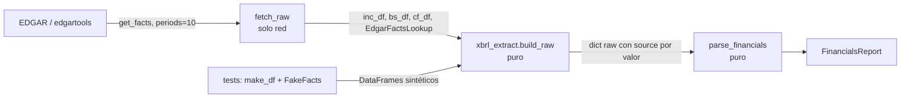

# Notas didácticas — Bloque B (H1, T5–T9) — pendiente de merge en `DETAILED_EXPLANATION.md`

Formato: concepto → por qué → cómo → relación con la arquitectura → ejemplo del código.
(Ruling R2: la sesión principal fusiona estas notas en `DETAILED_EXPLANATION.md`.)

---

## T5 — Seam de testabilidad XBRL (`xbrl_extract.py`)

**Concepto.** Una *seam* es un punto donde puedes sustituir una dependencia sin tocar el código que la usa. Aquí la seam separa "hablar con EDGAR" (red, no determinista) de "decidir qué número es el bueno" (lógica pura).

**Por qué.** Antes, toda la selección de conceptos y periodos vivía en closures dentro de `fetch_raw`. Los tests solo podían ejercitar `parse_financials` con fixtures JSON que eran el *output* de esa lógica: los bugs de selección (año equivocado, `periods=4`, 10-K/A) eran invisibles para la suite porque el fixture ya traía el resultado incorrecto congelado.

**Cómo.** `build_raw(...)` recibe tres DataFrames y un `FactsLookup` (Protocol con un único método `annual_value(concept, period)`). En producción el lookup es `EdgarFactsLookup` (indexa `get_all_facts()` una vez, empareja por `period_end`); en tests es `FakeFacts`, un dict. `fetch_raw` queda en ~20 líneas: descargar, construir el lookup, delegar.

**Por qué emparejar por `period_end` y no por `fiscal_year`.** En companyfacts, `fiscal_year` es el año *del filing*: el 10-K de FY2025 reporta también el balance comparativo de FY2024 y ambos facts llevan `fiscal_year=2025`. Filtrar por `fiscal_year` puede devolver el comparativo. El `period_end` (fecha de cierre) es inequívoco; se convierte a etiqueta con la misma regla que edgartools (cierre 1–7 enero → año anterior).

**Relación con la arquitectura.** Refuerza ADR-005 (números deterministas de fuente primaria) haciéndolos *verificables*: cada valor lleva `source` (concepto XBRL, `facts:<c>` o `derived:...`), y el invariante "etiqueta del 10-K == última columna" convierte un desalineamiento silencioso en `DataUnavailableError`.

**Ejemplo.** `point_value(df, ("Assets",), "FY2025")` con `FY 2025 = NaN, FY 2024 = 5.0` devuelve `None` (antes: `5.0` etiquetado FY2025 — EC-78).

---

## T6 — "Un total nunca se suma con sus componentes" (balance correcto)

**Concepto.** La taxonomía us-gaap tiene conceptos *total* y conceptos *componente* para la misma partida. `LongTermDebt` es la deuda a largo plazo **incluida** su porción corriente; `LongTermDebtNoncurrent` es solo la parte no corriente; `LongTermDebtCurrent` la corriente. `DebtCurrent` es el total de deuda corriente (porción corriente + papel comercial + préstamos CP).

**Por qué.** El extractor viejo tomaba `LongTermDebt` como "largo plazo" y luego sumaba como "corto plazo" todo lo que encontraba (`ShortTermBorrowings + LongTermDebtCurrent + ... + DebtCurrent`). Con AAPL (LTD 90, de los que 12 corrientes, más 8 de papel comercial) el doble conteo es inmediato: la porción corriente aparece dentro de `LongTermDebt` y otra vez como `LongTermDebtCurrent`.

**Cómo.** `resolve_debt` aplica una política *exclusiva*: elige UNA fuente por bloque (noncurrent explícito o total − corriente; `DebtCurrent` o borrowings + corriente) y deja constancia de cada inferencia en `flags`. Las identidades contables (`LongTermDebt ≈ noncurrent + current`; `Assets == Liabilities + Equity`) se usan como *checks*: la identidad estricta (Assets vs `LiabilitiesAndStockholdersEquity`) lanza `DataUnavailableError` porque si falla la extracción está corrupta; la blanda (Assets ≈ Liabilities + Equity) puede romperse legítimamente por *mezzanine/temporary equity*, así que solo marca.

**Relación con la arquitectura.** Invariante 5 (tools fallan loud): la caja ausente ya no es un 0 silencioso. La STI deja de ir dentro de `cash_and_equivalents`: un único significado por campo evita que el bridge EV→equity del Bloque C reste la STI dos veces. Las `data_quality_flags` viajan en el `FinancialsReport` para que la síntesis las muestre (T13).

**Ejemplo.** `resolve_debt` con `{LongTermDebt: 100, DebtCurrent: 15, CommercialPaper: 5}` → LT = 100 − (15 − 5) = 90, ST = 15, total 105 (antes 115), flag `"current LTD inferred from DebtCurrent (FY2025)"`.
