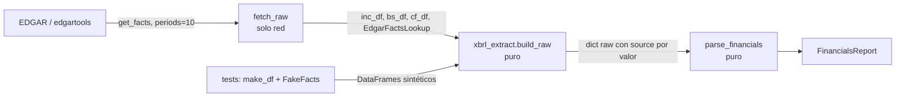

# Notas didácticas — Bloque B (H1, T5–T9) — pendiente de merge en `DETAILED_EXPLANATION.md`

Formato: concepto → por qué → cómo → relación con la arquitectura → ejemplo del código.
(Ruling R2: la sesión principal fusiona estas notas en `DETAILED_EXPLANATION.md`.)

---

## T5 — Seam de testabilidad XBRL (`xbrl_extract.py`)

**Concepto.** Una *seam* es un punto donde puedes sustituir una dependencia sin tocar el código que la usa. Aquí la seam separa "hablar con EDGAR" (red, no determinista) de "decidir qué número es el bueno" (lógica pura).

**Por qué.** Antes, toda la selección de conceptos y periodos vivía en closures dentro de `fetch_raw`. Los tests solo podían ejercitar `parse_financials` con fixtures JSON que eran el *output* de esa lógica: los bugs de selección (año equivocado, `periods=4`, 10-K/A) eran invisibles para la suite porque el fixture ya traía el resultado incorrecto congelado.

**Cómo.** `build_raw(...)` recibe tres DataFrames y un `FactsLookup` (Protocol con un único método `annual_value(concept, period)`). En producción el lookup es `EdgarFactsLookup` (indexa `get_all_facts()` una vez, empareja por `period_end`); en tests es `FakeFacts`, un dict. `fetch_raw` queda en ~20 líneas: descargar, construir el lookup, delegar.

**Por qué emparejar por `period_end` y no por `fiscal_year`.** En companyfacts, `fiscal_year` es el año *del filing*: el 10-K de FY2025 reporta también el balance comparativo de FY2024 y ambos facts llevan `fiscal_year=2025`. Filtrar por `fiscal_year` puede devolver el comparativo. El `period_end` (fecha de cierre) es inequívoco; se convierte a etiqueta con la misma regla que edgartools (cierre 1–7 enero → año anterior).

**Relación con la arquitectura.** Refuerza ADR-005 (números deterministas de fuente primaria) haciéndolos *verificables*: cada valor lleva `source` (concepto XBRL, `facts:<c>` o `derived:...`), y el invariante "etiqueta del 10-K == última columna" convierte un desalineamiento silencioso en `DataUnavailableError`.

**Ejemplo.** `point_value(df, ("Assets",), "FY2025")` con `FY 2025 = NaN, FY 2024 = 5.0` devuelve `None` (antes: `5.0` etiquetado FY2025 — EC-78).

---

## T6 — "Un total nunca se suma con sus componentes" (balance correcto)

**Concepto.** La taxonomía us-gaap tiene conceptos *total* y conceptos *componente* para la misma partida. `LongTermDebt` es la deuda a largo plazo **incluida** su porción corriente; `LongTermDebtNoncurrent` es solo la parte no corriente; `LongTermDebtCurrent` la corriente. `DebtCurrent` es el total de deuda corriente (porción corriente + papel comercial + préstamos CP).

**Por qué.** El extractor viejo tomaba `LongTermDebt` como "largo plazo" y luego sumaba como "corto plazo" todo lo que encontraba (`ShortTermBorrowings + LongTermDebtCurrent + ... + DebtCurrent`). Con AAPL (LTD 90, de los que 12 corrientes, más 8 de papel comercial) el doble conteo es inmediato: la porción corriente aparece dentro de `LongTermDebt` y otra vez como `LongTermDebtCurrent`.

**Cómo.** `resolve_debt` aplica una política *exclusiva*: elige UNA fuente por bloque (noncurrent explícito o total − corriente; `DebtCurrent` o borrowings + corriente) y deja constancia de cada inferencia en `flags`. Las identidades contables (`LongTermDebt ≈ noncurrent + current`; `Assets == Liabilities + Equity`) se usan como *checks*: la identidad estricta (Assets vs `LiabilitiesAndStockholdersEquity`) lanza `DataUnavailableError` porque si falla la extracción está corrupta; la blanda (Assets ≈ Liabilities + Equity) puede romperse legítimamente por *mezzanine/temporary equity*, así que solo marca.

**Relación con la arquitectura.** Invariante 5 (tools fallan loud): la caja ausente ya no es un 0 silencioso. La STI deja de ir dentro de `cash_and_equivalents`: un único significado por campo evita que el bridge EV→equity del Bloque C reste la STI dos veces. Las `data_quality_flags` viajan en el `FinancialsReport` para que la síntesis las muestre (T13).

**Ejemplo.** `resolve_debt` con `{LongTermDebt: 100, DebtCurrent: 15, CommercialPaper: 5}` → LT = 100 − (15 − 5) = 90, ST = 15, total 105 (antes 115), flag `"current LTD inferred from DebtCurrent (FY2025)"`.

---

## T7 — Índice vs año fiscal; por qué el snapshot trimestral nunca funcionó

**Concepto.** Una serie anual es un conjunto de pares (año fiscal, valor). La *posición* en la lista es un detalle de almacenamiento; el *año* es el dato. Todo cálculo que combine dos series (FCF = OCF − capex, margen = GP / revenue) o mida una distancia temporal (CAGR) debe usar el año, no la posición.

**Por qué.** BBW no tiene FY2025 en la vista curada de edgartools. Su revenue es `[FY2026, FY2024, FY2023, FY2022]`. El código viejo calculaba el "CAGR" con `revenue[3]` y exponente `1/3`, pero entre FY2026 y FY2022 hay 4 años: CAGR sobrestimado. Y `zip(ocf, capex)` emparejaba OCF de un año con capex de otro en cuanto una serie tenía un hueco que la otra no.

**Cómo.** `utils/periods.py`: `align_by_period(a, b)` empareja por etiqueta; `cagr_by_fiscal_years(series, max_years, scan_for_positive_start)` usa la diferencia real de años y acota la ventana. Con `periods=10` (T5) las series tienen hasta 10 años, así que cada consumidor fija su ventana explícitamente (5 años) y `tests/test_series_windows.py` lo comprueba con una serie sintética de 10 años. `backfill_gaps` rellena los huecos interiores desde raw facts.

**El snapshot trimestral.** El 10-Q de AAPL vía `get_quarterly_financials()` devuelve un DataFrame con `concept` como *columna* (`us-gaap_Revenues`) y columnas de periodo `"2026-06-27 (Q3)"`. El código buscaba columnas que empezaran por `"Q"` → ninguna → `None` siempre. El test que debía protegerlo afirmaba `get_filings.called or result is None`: como `result` era siempre `None`, el test pasaba siempre. **Lección:** un test cuya aserción es verdadera tanto si el código funciona como si no, no es un test (regla de `tests/CLAUDE.md`). Se sustituyó por uno con el formato real verificado en vivo.

**Relación con la arquitectura.** Refuerza ADR-005: los números deterministas solo son correctos si las operaciones entre series respetan el periodo. Arreglar el trimestral destapó que varios tests hacían una llamada real a EDGAR (enmascarada por el bug); `conftest.py` la bloquea ahora (zero real API calls).

**Ejemplo.** `cagr_by_fiscal_years([FY2026: 529.8, FY2024: 486.1, FY2023: 467.9, FY2022: 411.5], max_years=5)` → `n = 4`, CAGR = (529.8/411.5)^(1/4) − 1 ≈ 6,5 % (antes exponente 1/3 → ≈ 8,8 %).

---

## T8 — FCFF y sus inputs (extracciones nuevas)

**Concepto.** El FCFF (*free cash flow to the firm*) es la caja que genera el negocio para TODOS los financiadores (accionistas y acreedores), antes de pagarles. Se descuenta al WACC y da el *enterprise value*; el bridge EV→equity resta después la deuda neta. Es el marco único de valoración elegido para H1 (ADR-033).

**Por qué hacen falta inputs nuevos.** Partiendo del OCF (US GAAP): (1) el OCF ya restó los intereses pagados → hay que sumarlos netos de impuestos (`interest_expense`); (2) incluye intereses cobrados sobre la caja, que el bridge ya suma como caja → se restan (`interest_income`); (3) la SBC es un coste real aunque no sea caja (Damodaran) → `sbc`; (4) el principal de leasings financieros es capex disfrazado → `finance_lease_principal_payments`. Para pasar del equity a "por acción" hace falta el recuento correcto: la media ponderada **diluida** (`diluted_shares`) y la **básica** (`basic_shares_weighted`) permiten escalar el recuento puntual de portada (`shares_outstanding × diluidas/básicas`) sin sobrecontar en empresas con recompras fuertes.

**Cómo.** `extract_annual(concepts, dfs, facts, labels)`: primero la vista curada (+ relleno de huecos); si el concepto no está (la vista curada omite muchos de estos), raw facts en la MISMA rejilla de años que el revenue, para que todo se alinee por periodo. Los memos de balance (`operating_lease_liabilities`, `operating_rou_asset`, `equity_method_investments`, `minority_interest`, `preferred_stock`) se extraen pero NO entran en `total_debt`: el leasing operativo ya reduce OCF y EBIT, restarlo además en el bridge lo cobraría dos veces.

**Signos.** Intereses, SBC, D&A y principal se guardan en magnitud (`_mv_list_abs`): el signo varía por filer y edgartools 5.5x devuelve los flujos con signo. Los intereses cobrados conservan su signo.

**Relación con la arquitectura.** Todos los campos nuevos tienen default (`[]`/`None`), así los 51 fixtures y reports históricos siguen cargando; el Bloque C (T10–T13) es el consumidor. `income_tax`/`pretax_income` se exponen para el tipo impositivo canónico `effective_tax_rate_multi`.

**Ejemplo.** Con la vista curada sin `InterestExpense` pero raw facts con FY2025=2.0 y FY2024=1.5, `extract_annual(INTEREST_EXPENSE, ...)` → `[{2.0, FY2025, "facts:InterestExpense"}, {1.5, FY2024, "facts:InterestExpense"}]`.
